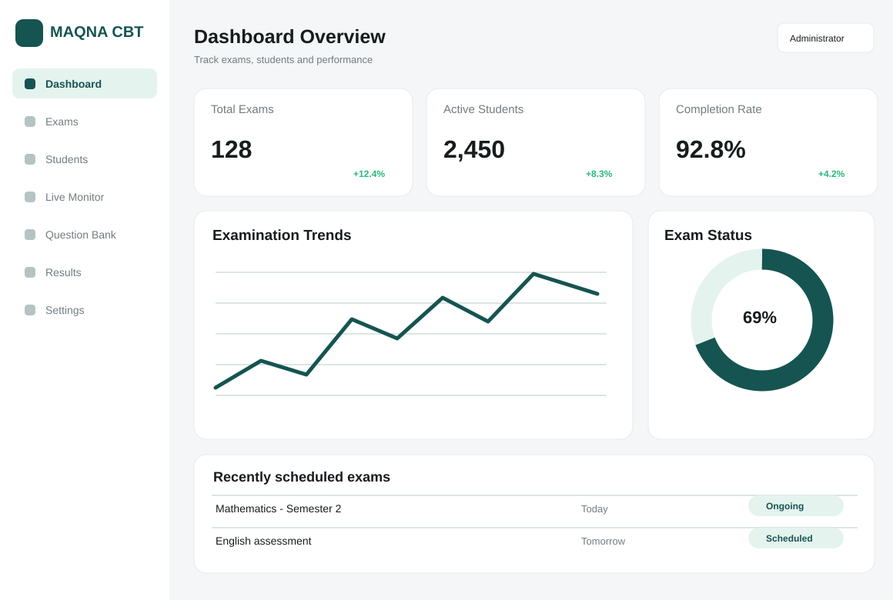
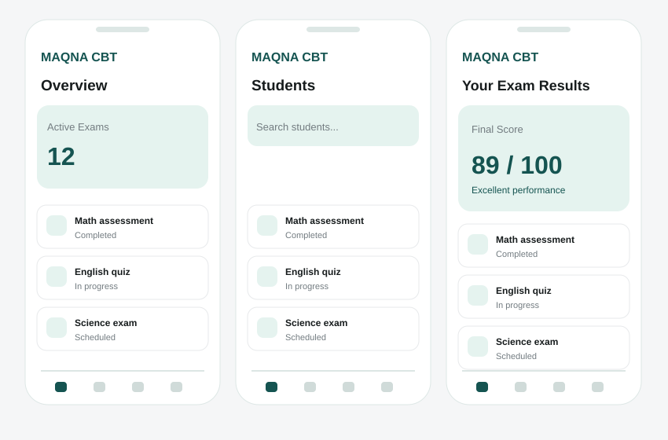
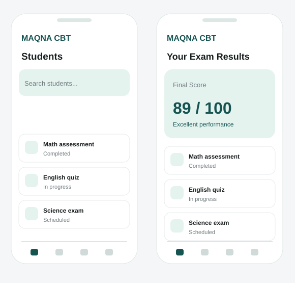
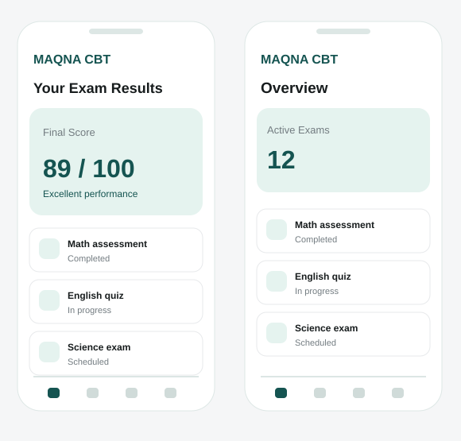
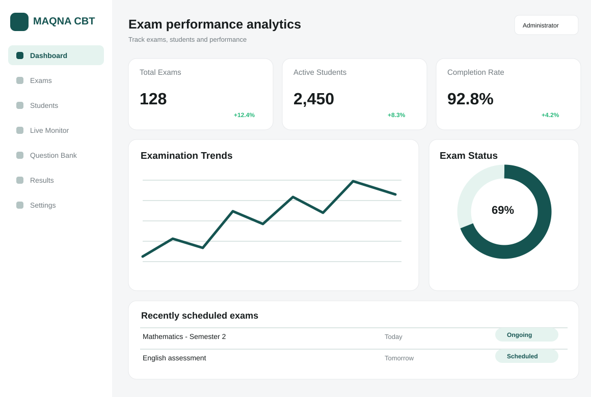
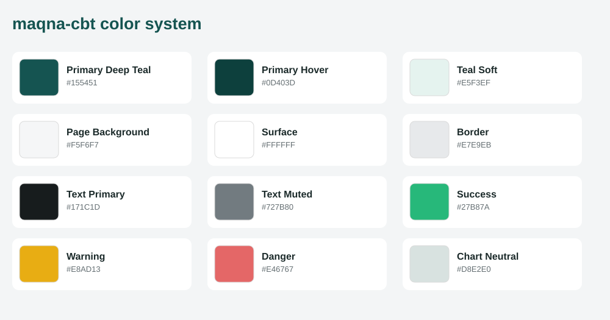
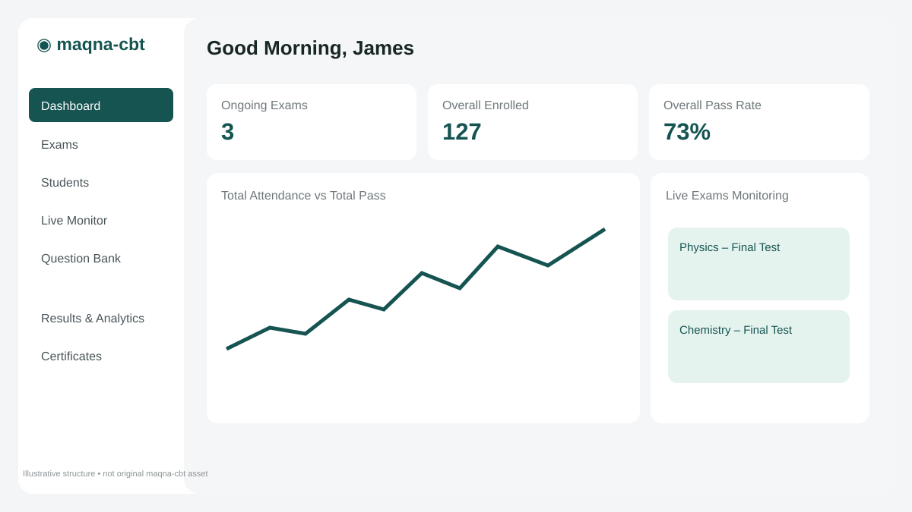
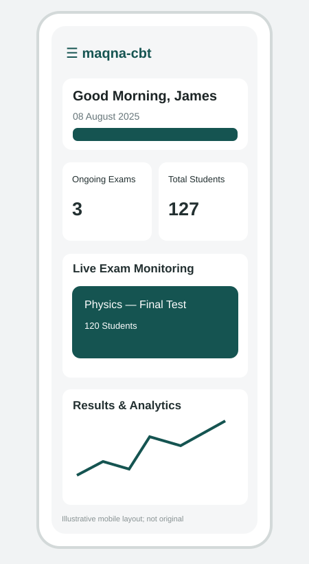

# MAQNA CBT — UI Design System & Asset Reference

> **Status:** design-system rekonstruksi berbasis screenshot publik, **bukan** file Figma resmi, export token asli, atau lisensi penggunaan ulang aset desainer.  
> **Project:** [Testora — Online Exam SaaS UX/UI Dashboard Design](https://www.behance.net/gallery/233259467/Testora-Online-Exam-SaaS-UX-UI-Dashboard-Design), oleh Opedia Studio, terbit 25 Agustus 2025.  
> **Sumber tambahan:** [Dribbble / Opedia Studio](https://dribbble.com/shots/26455254-Testora-Online-Exam-SaaS-UX-UI-Dashboard-Design).  
> **Cara melihat:** file `.md` dapat dipreview di VS Code atau GitHub. Semua gambar yang dirender dalam Markdown disimpan lokal pada folder `assets/` dan tersedia offline. Ilustrasi UI dibuat ulang secara independen sebagai **contoh**, bukan screenshot asli dari karya referensi. Tautan sumber eksternal hanya dipakai jika ingin mengunjungi karya aslinya.

## 1. Galeri ilustrasi offline (bukan screenshot asli)

> Semua ilustrasi di bagian ini adalah rekonstruksi skematis untuk acuan implementasi, bukan reproduksi desain milik Opedia Studio.

### 1.1 Desktop dashboard


### 1.2 Responsif — Home, Students, Analytics


### 1.3 Enrollment dan chart di mobile


### 1.4 Mobile result/analytics


### 1.5 Mobile exam results overview


### 1.6 Desktop dashboard close-up


## 2. Warna / color palette

**Penting:** Kode HEX di bawah merupakan *nilai rekomendasi berdasarkan tampilan* untuk membangun UI serupa; tidak diverifikasi sebagai warna asli dari file desain. Palet otomatis Dribbble tidak sama dengan dokumentasi design tokens desainer.



| Token | HEX usulan | Kegunaan |
|---|---|---|
| `primary-deep-teal` | `#155451` | Primary navigation, CTA |
| `primary-hover` | `#0D403D` | Hover active actions |
| `teal-soft` | `#E5F3EF` | Subtle panels |
| `page-background` | `#F5F6F7` | Dashboard canvas |
| `surface` | `#FFFFFF` | Cards and panels |
| `border` | `#E7E9EB` | Dividers |
| `text-primary` | `#171C1D` | Headlines |
| `text-muted` | `#727B80` | Captions |
| `success` | `#27B87A` | Positive status |
| `warning` | `#E8AD13` | Warnings |
| `danger` | `#E46767` | Critical alerts |
| `chart-neutral` | `#D8E2E0` | Chart background |

### CSS variables

```css
:root {
  --color-primary: #155451;
  --color-primary-hover: #0D403D;
  --color-primary-subtle: #E5F3EF;
  --color-page: #F5F6F7;
  --color-surface: #FFFFFF;
  --color-border: #E7E9EB;
  --color-text: #171C1D;
  --color-muted: #727B80;
  --color-success: #27B87A;
  --color-warning: #E8AD13;
  --color-danger: #E46767;
  --color-chart-neutral: #D8E2E0;
}
```

### Semantic usage

- Primary CTA / active sidebar → `primary` dengan teks putih.
- Secondary/neutral → latar surface dengan border dan teks utama.
- Metrik naik / lulus → `success` (jangan hanya gunakan warna: tambahkan teks atau ikon).
- Alert pengawasan / terlambat → `warning`; error/expired → `danger`.
- Grafik → teal untuk data penting, abu-teal untuk pembanding, kuning sebagai sorotan.

## 3. Typography

**Tidak ada bukti nama font resmi dari screenshot.** Gunakan **Inter** sebagai rekomendasi implementasi, fallback `Arial, sans-serif`. Estimasi ukuran desktop/mobile:

| Style | Desktop | Mobile | Weight | Line height |
|---|---|---|---|---|
| Page heading | 28–32px | 22–24px | 600–700 | 1.2 |
| Section heading | 18–22px | 17–18px | 600–700 | 1.3 |
| Card title | 16–18px | 15–16px | 600 | 1.3 |
| Body | 14–16px | 14px | 400 | 1.5 |
| Small text | 12–13px | 12px | 400–500 | 1.4 |
| KPI value | 26–34px | 22–28px | 600–700 | 1.15 |
| Button | 13–14px | 13–14px | 500–600 | 1.2 |

```css
:root { --font-family-ui: Inter, Arial, sans-serif; }
body { font-family: var(--font-family-ui); font-size: 14px; line-height: 1.5; color: var(--color-text); }
```

## 4. Grid, spacing, dimensions

Ini adalah **spesifikasi implementasi yang direkomendasikan**, bukan ukuran yang diekstrak dari Figma.

| Elemen | Desktop >=1200px | Tablet 768–1199px | Mobile <768px |
|---|---|---|---|
| Sidebar | 220–248px fixed | 68–80px collapsed atau drawer | off-canvas drawer |
| Main gap | 20–24px | 16–20px | 12–16px |
| Content padding | 24–32px | 20–24px | 12–16px |
| KPI grid | 3–4 kolom | 2 kolom | 2 atau 1 kolom |
| Dashboard analytics | 2:1 (chart + monitoring) | 1:1 / stacked | 1 kolom |
| Card radius | 12–16px | 12–16px | 12px |
| Button height | 40–44px | 40–44px | 44–48px |
| Table | full + overflow jika perlu | horizontal scroll | card list atau scroll |
| Chart | full available width | responsive width | reduced labels / legend below |

**Spacing scale (4px):** `4, 8, 12, 16, 20, 24, 32, 40, 48, 64px`.

**Radius scale:** `6, 8, 12, 16, 24, 9999px` (pill).

**Shadow:** `0 1px 3px rgba(0,0,0,.04)` atau border `1px solid #E7E9EB`, tidak heavy shadow.

## 5. Layout mockup interpretasi

Gambar SVG di bawah adalah *diagram buatan sendiri untuk pengembangan*, bukan desain resmi yang disalin atau screenshot asli.

### Desktop structure


### Mobile structure


## 6. Component inventory

| Komponen | Struktur | Interaksi | Adaptasi mobile |
|---|---|---|---|
| Sidebar | Logo, grouped menu, active item, settings | Active, hover, focus | Hamburger + drawer |
| Header | Greeting, tanggal, ikon notifikasi, profile | Menu, notifications | Judul ringkas + ikon |
| KPI card | Title, angka, status delta, icon | Tooltip opsional | 2 kolom / stacked |
| Action button | Icon + label, solid teal | hover, focus, disabled, loading | width full jika CTA utama |
| Dashboard graph | Judul, legend, filter period, chart | Tooltip, filter | legend ke bawah |
| Live exams | Exam name, kelas, timer, siswa, status | Detail / monitor | stacked cards |
| Data table | Search, filter, columns, paging | sort / filter / pagination | card format jika sempit |
| Question analytics | difficulty split, correctness, bars | tooltips | horizontal bars |
| Donut/gauge | number, label, chart segments | optional hover | scale to width |
| Form field | label, placeholder, helper, error | validate, focus | full width |
| Badge | status label + semantic color | tooltip optional | same |
| Empty state | illustration/icon + message + CTA | action | centered |
| Modal / drawer | header, content, footer actions | close, confirm | bottom sheet/full screen |
| Progress | bar + numeric labels | updated by state | bar full width |

### Sidebar information architecture (tampilan yang terlihat)

```text
MAIN MENU
├── Dashboard
├── Exams
├── Students
├── Live Monitor
└── Question Bank

MANAGEMENT
├── Results & Analytics
├── Certificates
└── Settings
```

## 7. Daftar halaman untuk desain CBT

Yang terlihat pada case study terutama **dashboard/admin exam management**, bukan bukti seluruh layar pelaksanaan ujian peserta. Halaman pengerjaan soal di bawah merupakan **usulan pengembangan CBT** agar desain sistem utuh:

1. Dashboard overview — KPI, active exams, attendance chart.
2. Exams list — filter, search, status, schedule, create exam.
3. Create/edit exam — title, schedule, duration, attempts, scoring, participants.
4. Student management — enrollment, student details, attendance.
5. Question bank — questions, types (MCQ, written, viva), import/export.
6. Live monitor — ongoing sessions, alerts, remaining time, candidates.
7. Exam participant view **(usulan)** — question, answer options, countdown, question palette, flag, next/previous, submit confirmation.
8. Results & analytics — passing rate, highest score, question-level analysis, export.
9. Certificates — generated results/certificates.
10. Settings — account, permissions, notifications, exam policy.

## 8. Exam-taking page — rekomendasi desktop/mobile

**Desktop:** top bar (subject + timer), left main column (soal dan pilihan), right sidebar (nomor soal, marked/answered/unanswered), sticky bottom controls.  
**Mobile:** top bar (judul pendek + timer), pertanyaan dan pilihan full width, palette nomor soal dalam drawer/bottom sheet, tombol Previous/Next mudah dijangkau, konfirmasi Submit terpisah.  
**Accessibility:** focus visible, target sentuh minimum 44 × 44px, status tidak berdasarkan warna saja, konten gambar memiliki alt text, keyboard navigation, contrast minimal sesuai WCAG AA.

## 9. Breakpoints & responsive CSS starter

```css
.app-shell { display: grid; grid-template-columns: 236px minmax(0,1fr); min-height: 100vh; background: var(--color-page); }
.app-sidebar { background: var(--color-surface); border-right: 1px solid var(--color-border); }
.app-main { min-width: 0; padding: 28px; }
.stats-grid { display: grid; grid-template-columns: repeat(3,minmax(0,1fr)); gap: 16px; }
.dashboard-grid { display: grid; grid-template-columns: minmax(0,2fr) minmax(300px,1fr); gap: 20px; }
.ui-card { background: var(--color-surface); border: 1px solid var(--color-border); border-radius: 14px; padding: 20px; }
.ui-button-primary { background: var(--color-primary); color: white; border: 0; border-radius: 8px; min-height: 44px; padding: 0 16px; }
.ui-button-primary:hover { background: var(--color-primary-hover); }
.ui-button-primary:focus-visible { outline: 3px solid #A0D5CB; outline-offset: 2px; }
@media (max-width: 1199px) {
  .dashboard-grid { grid-template-columns: 1fr; }
  .stats-grid { grid-template-columns: repeat(2,minmax(0,1fr)); }
}
@media (max-width: 767px) {
  .app-shell { display: block; }
  .app-sidebar { display: none; } /* ganti dengan drawer accessible di aplikasi */
  .app-main { padding: 16px; }
  .stats-grid { grid-template-columns: repeat(2,minmax(0,1fr)); gap: 10px; }
  .ui-card { padding: 14px; border-radius: 12px; }
}
@media (max-width: 360px) {
  .stats-grid { grid-template-columns: 1fr; }
}
```

## 10. CSS token set untuk developer

```css
:root {
  --space-1: 4px; --space-2: 8px; --space-3: 12px; --space-4: 16px;
  --space-5: 20px; --space-6: 24px; --space-8: 32px;
  --radius-sm: 8px; --radius-md: 12px; --radius-lg: 16px;
  --sidebar-width: 236px;
  --shadow-card: 0 1px 3px rgba(0,0,0,.04);
  --transition-fast: 150ms ease;
}
```

## 11. Asset manifest dan status

- `assets/palette.svg`: ilustrasi palet warna, dibuat untuk dokumen ini.
- `assets/desktop-layout.svg`: diagram layout desktop, dibuat untuk dokumen ini.
- `assets/mobile-layout.svg`: diagram layout mobile, dibuat untuk dokumen ini.
- **Seluruh gambar yang tampil dalam dokumen kini lokal** (SVG dalam `assets/`). Ilustrasi pengganti bukan screenshot karya asli. Hak cipta desain referensi tetap milik pemiliknya.
- **Belum tersedia/terverifikasi:** file Figma asli, icon SVG asli, font name asli, logo vector, design token export, komponen interaktif, lisensi pemakaian aset.

## 12. Tautan sumber desain asli (opsional, memerlukan internet)

> URL berikut hanyalah referensi sumber, **bukan dependency Markdown**. Dokumen, semua ilustrasi dan file CSS dapat dipakai tanpa internet.

- **desktop-overview**: https://mir-s3-cdn-cf.behance.net/project_modules/1400_webp/98187b233259467.68ac776db99e4.jpg
- **mobile-responsive**: https://mir-s3-cdn-cf.behance.net/project_modules/1400_webp/2e5543233259467.68ac776dbaadc.jpg
- **mobile-enrollment**: https://mir-s3-cdn-cf.behance.net/project_modules/1400_webp/28a5e0233259467.68ac7da610d97.jpg
- **mobile-lifestyle**: https://mir-s3-cdn-cf.behance.net/project_modules/1400_webp/c9d4bc233259467.68ac776db9443.jpg
- **analytics-mobile**: https://cdn.dribbble.com/userupload/44682045/file/3892d39db9814031238f991ac8b43f8f.jpg
- **desktop-detail**: https://cdn.dribbble.com/userupload/44682028/file/5a6d9d318152a4b090bddb0d21b26cc9.jpg
- **research**: https://mir-s3-cdn-cf.behance.net/project_modules/1400_webp/10a79c233259467.68ac7da6117ec.jpg
- **goals**: https://mir-s3-cdn-cf.behance.net/project_modules/1400/b849e2233259467.68ac776db2076.jpg
- **problems**: https://mir-s3-cdn-cf.behance.net/project_modules/1400_webp/1b417b233259467.68ac776db4687.jpg

## 13. Catatan lisensi dan ketepatan

Desain referensi milik Opedia Studio/kontributor terkait. Sumber Behance menyebut seluruh elemen grafis digunakan untuk konsep desain. Dokumen ini adalah **analisis referensi untuk implementasi orisinal**, bukan paket asset resmi siap pakai. Jika ingin menggunakan ulang logo, foto, ilustrasi, atau screenshot untuk tujuan publik/komersial, minta izin pemegang hak. Verifikasi warna, spacing, typography, dan ukuran persis melalui file Figma resmi bila tersedia.


## 13. Cara membuka sepenuhnya offline

1. Ekstrak seluruh isi ZIP tanpa memisahkan `MAQNA_CBT_DESIGN_SYSTEM.md` dan folder `assets/`.
2. Buka file Markdown dalam VS Code dan jalankan **Markdown: Open Preview** (`Ctrl+Shift+V`), atau gunakan viewer Markdown lokal lain yang mendukung SVG.
3. Tidak dibutuhkan internet: semua `![...]` menunjuk pada `assets/*.svg`. Tautan menuju Behance/Dribbble pada bagian sumber hanya opsional.

### Batasan

Screenshot asli dari CDN Behance/Dribbble belum dapat diunduh. Oleh karena itu, untuk menjaga paket sepenuhnya offline tanpa tautan gambar rusak, screenshot asli **digantikan oleh ilustrasi lokal**. Untuk mendapatkan screenshot asli offline, file gambar aslinya perlu diunduh secara terpisah dari pemilik/sumber yang mengizinkan penggunaan dan dimasukkan ke `assets/`.
