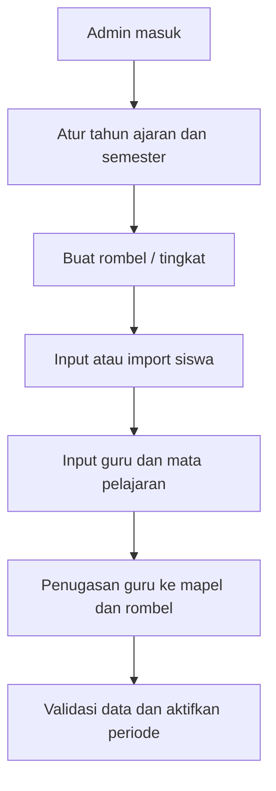
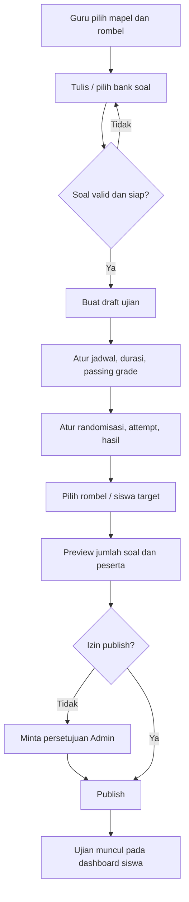
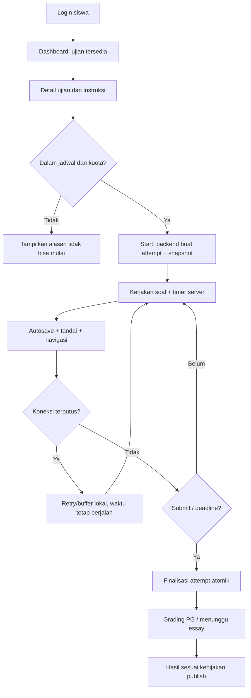

# maqna-cbt — Spesifikasi Fungsional Sekolah & Madrasah

**Versi:** 1.1 (draft kebutuhan untuk validasi)  
**Tanggal:** 14 November 2026  
**Produk:** maqna-cbt — Computer Based Test untuk sekolah/madrasah  
**Frontend:** React + TypeScript + Vite, shadcn/ui, Tailwind CSS  
**Backend:** CodeIgniter 4 REST API  
**Target perangkat:** Desktop, tablet, dan mobile (browser)  
**Cakupan:** 38 fitur yang telah dipilih, ditambah kebutuhan akademik pendukung yang ditandai terpisah.

> Semua aturan di dokumen ini adalah **usulan spesifikasi**, bukan klaim bahwa fitur sudah selesai dibuat. Item bertanda **Keputusan terbuka** perlu disetujui sebelum development.

## 1. Visi, cakupan, dan batasan

Maqna-cbt membantu sekolah/madrasah menyusun bank soal, menjadwalkan ujian berdasarkan rombel, menjalankan ujian yang dapat di-resume setelah koneksi putus, memeriksa hasil, dan mengelola laporan per tahun ajaran/semester. Sekolah bisa menggunakan aplikasi untuk Penilaian Harian (PH), Sumatif Tengah Semester (STS), Sumatif Akhir Semester (SAS), Penilaian Akhir Tahun (PAT), ujian sekolah/madrasah, dan tryout; nama jenis ujian dapat dikonfigurasi.

**Keputusan desain default:** satu institusi pada rilis awal, bahasa antarmuka Indonesia, zona waktu sekolah `Asia/Jakarta` secara default, timestamp backend disimpan konsisten (UTC disarankan), web responsif. Sistem dirancang supaya dapat ditambah multi-institusi nanti, tetapi pengelolaan banyak tenant bukan bagian rilis pertama.

**Di luar cakupan saat ini:** pendaftaran siswa baru/PPDB, LMS lengkap, pembayaran, rapor akademik menyeluruh, penjadwalan pelajaran, aplikasi mobile native, ujian benar-benar offline, proctoring kamera/mikrofon, dan AI grading otomatis essay.

### 1.1 Struktur akademik yang diperlukan (kebutuhan pendukung)

| Entitas | Fungsi | Aturan penting |
|---|---|---|
| Sekolah/Madrasah | Profil institusi; nama, logo, NPSN opsional | Satu institusi aktif pada rilis pertama; `school_id` opsional untuk ekspansi |
| Jenjang | MI/MTs/MA atau SD/SMP/SMA/SMK | Label bisa dipilih sesuai institusi, tidak dipaksakan |
| Tahun ajaran | Mis. 2026/2027 | Satu tahun ajaran aktif; data historis tetap dapat ditelusuri |
| Semester | Ganjil/Genap | Ujian terhubung ke satu semester dan tahun ajaran |
| Tingkat | Mis. VII, VIII, IX atau X–XII | Dapat disesuaikan menurut jenjang |
| Kelas/Rombel | Mis. VII-A | Memiliki tahun ajaran, wali kelas opsional, dan keanggotaan siswa |
| Siswa | Akun peserta CBT | NIS lokal unik; NISN opsional, tidak ditampilkan berlebihan |
| Guru | Akun pengajar | Mengampu mapel pada satu/lebih rombel; NIP/NUPTK opsional |
| Mata pelajaran | Mis. Matematika, Bahasa Arab, Fikih, Akidah Akhlak, Al-Qur'an Hadis, SKI | Dikelola sekolah, tidak hard-coded |
| Penugasan mengajar | Hubungan guru–mapel–rombel–tahun ajaran | Menentukan ruang lingkup bank soal, ujian, dan laporan guru |
| Keanggotaan rombel | Hubungan siswa–rombel–tahun ajaran | Riwayat tidak dihapus saat naik kelas/pindah rombel |

**Kebutuhan pendukung:** master tahun ajaran, semester, rombel, relasi siswa-rombel, dan penugasan guru perlu masuk **P0** meskipun tidak menjadi butir eksplisit dalam daftar 38 fitur. Tanpanya penugasan ujian dan pembatasan akses guru tidak akurat.

## 2. Model peran dan akses

### 2.1 Role

1. **Super Admin (SADM)**: konfigurasi teknis, manajemen permission, pengaturan institusi, audit lintas modul. Tidak dipakai untuk tugas harian.
2. **Admin Sekolah/Operator (ADM)**: master akademik, registrasi siswa/guru, pengaturan jadwal, penugasan, laporan, penanganan sesi sesuai kewenangan.
3. **Guru/Pengajar (GRU)**: bank soal dan ujian mata pelajaran/rombel yang diampu, penilaian essay, publikasi hasil jika diizinkan.
4. **Pengawas Ujian (PWS)**: dashboard pengawasan ujian yang ditugaskan, status peserta, dan pencatatan insiden; tidak mengubah soal atau nilai. Role tambahan: monitoring penuh masuk P2.
5. **Siswa/Peserta (SIS)**: ujian yang ditugaskan, attempt aktif, hasil dirinya sendiri yang sudah dirilis.

Satu akun dapat memiliki beberapa role, tetapi izin efektif perlu dievaluasi terhadap **aksi + resource + scope**. Peran pengawas dapat dibuat sebagai role teknis sejak P0, sedangkan panel monitoring real-time menyusul P2.

### 2.2 Matriks izin

Legenda: **C** create, **R** read, **U** update, **D** delete/nonaktif, **P** publish/approve, **M** monitor, **S** submit. Tanda `*` = hanya resource dalam lingkup penugasan; `◦` = kebijakan sekolah.

| Modul/Aksi | SADM | ADM | GRU | PWS | SIS |
|---|---|---|---|---|---|
| Konfigurasi sistem dan izin | CRUD | R terbatas | — | — | — |
| Tahun ajaran / semester | CRUD | CRUD | R | R terbatas | R terbatas |
| Rombel, siswa, guru, assignment | CRUD | CRUD | R* | R* | R diri |
| Mata pelajaran, kategori, topik | CRUD | CRUD | CRU* | R* | — |
| Bank soal / kunci jawaban | CRUD | CRUD | CRUD* | — | — |
| Membuat/mengedit ujian draft | CRUD | CRUD | CRUD* | — | — |
| Publish/close ujian | P | P | P* ◦ | — | — |
| Menugaskan kelas/siswa | CRUD | CRUD | CU* ◦ | R* | — |
| Memulai / mengerjakan attempt | — | — | — | — | S diri |
| Monitoring basic / real-time | M | M | M* | M* | — |
| Reset/membatalkan attempt | U + audit | U + audit | U* ◦ + audit | Usulkan saja | — |
| Menilai essay | U | U | U* | — | — |
| Melihat seluruh hasil | R | R | R* | Status saja | R diri* |
| Publish/release hasil | P | P | P* ◦ | — | — |
| Export laporan | R | R | R* | — | — |
| Audit log | R | R◦ | R* ◦ | — | — |
| Profil & ganti password | U diri | U diri | U diri | U diri | U diri |

**Aturan wajib:** API memeriksa izin dan scope, bukan mengandalkan route guard React. Guru hanya mendapat data kelas/mata pelajaran yang ditugaskan; siswa hanya `student_id` miliknya. Super Admin tidak otomatis boleh masuk ujian sebagai siswa.

### 2.3 Scope dan privasi

- Data hasil ujian milik siswa hanya terlihat oleh siswa tersebut setelah dirilis, atau oleh petugas berizin yang memiliki scope.
- Guru yang tidak mengampu rombel tidak dapat membaca hasil rombel itu hanya dengan mengganti ID URL.
- Riwayat perpindahan siswa dari VIII-A ke IX-B tidak mengubah kepemilikan attempt pada VIII-A tahun lalu.
- Log sensitif melacak perubahan peran, publikasi nilai, reset attempt, dan akses ekspor; jangan menyimpan password, token mentah, dan data jawaban di log aplikasi umum.
- Data siswa di bawah umur harus ditangani menurut kebijakan privasi sekolah dan aturan yang berlaku; retensi serta kebutuhan persetujuan ditetapkan institusi.

## 3. Prioritas 38 fitur

| Prioritas | Jumlah | Sasaran |
|---|---:|---|
| **P0** | **25** | Operasional pilihan ganda end-to-end, ditambah struktur akademik pendukung |
| **P1** | **8** | Efisiensi administrasi, essay, matematika, publikasi lebih kaya, tata kelola |
| **P2** | **5** | Versi soal, paket soal, anti-cheat berbasis sinyal, monitoring, analitik butir |

### 3.1 Authentication & akun

| ID | Prioritas | Fitur | Aturan fungsional dan acceptance criteria |
|---|---|---|---|
| FR-01 | P0 | Login / logout | Akun siswa/guru/operator login menggunakan username atau email dan password. Gagal login dibatasi rate; logout mencabut sesi; route privat menolak akses tanpa login. |
| FR-02 | P0 | RBAC | Permission berbasis role dan objek: permission, school scope, teacher assignment, serta kepemilikan. API mengembalikan 401/403 yang sesuai. |
| FR-03 | P0 | Manajemen peserta dan pengajar | Admin CRUD/nonaktif siswa/guru; dapat menempatkan siswa pada rombel, memberi guru penugasan mapel+kelas, melakukan pencarian dan filter. Data historis tidak hilang ketika akun dinonaktifkan. |
| FR-04 | P0 | Reset password | Admin dapat memicu reset yang aman; self-service reset via email bila tersedia, token sekali-pakai dan expired. Tidak mengungkap akun valid melalui pesan publik. |
| FR-05 | P0 | Profil dan pengaturan akun | Ubah profil terbatas, foto opsional, ganti password; siswa tidak dapat mengubah NIS/NISN atau rombel sendiri. |

### 3.2 Master akademik & bank soal

| ID | Prioritas | Fitur | Aturan fungsional dan acceptance criteria |
|---|---|---|---|
| FR-06 | P0 | Kategori, mata pelajaran, topik | Hierarki bisa memakai kelompok kategori → mata pelajaran → topik/bab. Guru dapat membuat topik sesuai penugasan. Resource yang sudah digunakan ujian tidak boleh dihapus permanen. |
| FR-07 | P0 | Soal pilihan ganda | Editor soal + opsi A–E (minimal 2), satu jawaban benar untuk MVP, bobot, tingkat kesulitan opsional, pembahasan opsional; draft dapat disimpan. Kunci jawaban dilarang dalam response API pengerjaan. |
| FR-08 | P0 | Gambar pada soal / opsi | Upload gambar yang dibatasi MIME, ukuran, dimensi; simpan metadata; render adaptif pada soal dan opsi tanpa overflow di mobile; file dicek otorisasi. |
| FR-09 | P1 | Soal essay | Jawaban teks panjang, rubric, skor maksimum dan penilai manual. Hasil campuran PG+essay berstatus `pending_review` sampai semua essay disahkan. |
| FR-10 | P1 | Import soal Excel | Template standar (kelas/mapel/topik/pertanyaan/opsi/kunci/bobot); preview, validasi baris, laporan error, konfirmasi import dan penanganan duplikasi. |
| FR-11 | P1 | Rumus matematika | Simpan formula berformat LaTeX aman, preview dengan KaTeX/MathJax, render konsisten di editor guru dan UI siswa, rumus tetap terbaca di mobile. |
| FR-12 | P2 | Versi dan review soal | Revisi 1, 2, dst; status draft → review → approved → archived; reviewer terpisah jika diperlukan. Attempt tetap menggunakan snapshot versi saat ujian dimulai. |

### 3.3 Manajemen ujian

| ID | Prioritas | Fitur | Aturan fungsional dan acceptance criteria |
|---|---|---|---|
| FR-13 | P0 | Membuat / mengedit ujian | Exam wizard: identitas → pilih bank soal → waktu & aturan → target rombel/siswa → review → publish. Setelah attempt dimulai, perubahan yang memengaruhi penilaian hanya berlaku untuk versi/publikasi berikut. |
| FR-14 | P0 | Durasi dan jadwal | Ujian punya `start_at`, `end_at`, `duration_minutes`, timezone display. Start hanya dalam jendela. Deadline attempt default = paling awal dari (`started_at + duration`) dan `end_at`. |
| FR-15 | P0 | Penugasan peserta | Target kelas/rombel dan pengecualian siswa individual. Daftar peserta terhitung dari snapshot keanggotaan saat publish/assign (usulan). Siswa yang tidak terdaftar mendapat 403. |
| FR-16 | P0 | Randomisasi soal & opsi | Konfigurasi terpisah shuffle questions dan shuffle options. Backend menyimpan urutan & pemetaan opsi untuk tiap attempt; refresh tidak berubah. |
| FR-17 | P0 | Batas percobaan | `max_attempts` >= 1; satu attempt aktif per siswa per ujian. Percobaan terhitung saat attempt berhasil dimulai; reset hanya operator berizin + alasan + audit. |
| FR-18 | P0 | Konfigurasi passing grade | Nilai minimum lulus berupa angka 0–100 per ujian. Jika essay belum dinilai, status lulus ditunda. |
| FR-19 | P0 | Pengaturan tampilan hasil | Opsional: sembunyikan seluruh hasil, tampilkan nilai segera, setelah jendela ujian ditutup, atau publish manual. Kunci dan pembahasan dikendalikan terpisah dari nilai. |
| FR-20 | P1 | Token / kode akses | Operator menyiapkan kode ujian; kode diverifikasi saat start, bukan mengganti login; dapat disertai jadwal berlaku dan rate limiting. |
| FR-21 | P2 | Paket soal berbeda | Paket A/B atau pengambilan pool soal berdasarkan kriteria; semua paket memakai kebijakan scoring setara; identitas paket tetap per attempt. |

### 3.4 Exam engine siswa

| ID | Prioritas | Fitur | Aturan fungsional dan acceptance criteria |
|---|---|---|---|
| FR-22 | P0 | Timer ujian | Timer mengambil `deadline_at` dari backend; melakukan sinkronisasi periodik; saat expired, server menutup attempt, dan semua save setelah deadline ditolak. |
| FR-23 | P0 | Autosave jawaban | Debounce + antrian request; state `pending/saving/saved/error`; server melakukan version/revision check agar request lama tak menimpa pilihan baru. |
| FR-24 | P0 | Navigasi nomor soal | Palet nomor, status belum dijawab/terjawab/ditandai; desktop sidebar kanan, mobile Sheet/Drawer. Pindah nomor tidak menghapus jawaban. |
| FR-25 | P0 | Tandai untuk ditinjau | Flag mark/unmark disimpan per `attempt_question` dan pulih saat refresh; ditampilkan dalam ringkasan akhir. |
| FR-26 | P0 | Submit manual dan otomatis | Konfirmasi jumlah kosong sebelum submit. Saat deadline server finalize otomatis. Endpoint submit idempotent dan hasil tidak dihitung dua kali. |
| FR-27 | P0 | Resume saat koneksi putus | Reload/relogin kembali ke attempt aktif beserta urutan soal dan jawaban tersimpan; buffer lokal dapat mengirim ulang ketika masih valid. Tidak ada pause waktu otomatis. |
| FR-28 | P2 | Deteksi pindah tab | Catat `visibilitychange`/fokus secara terbatas sebagai indikator; berikan peringatan yang tidak mengganggu; jangan otomatis menyimpulkan curang. |
| FR-29 | P2 | Monitoring real-time | Monitor status siswa (belum mulai/aktif/disconnected/selesai/expired), jumlah jawaban, remaining time dan event. Gunakan polling P2 awal; WebSocket bila memang dibutuhkan. |

### 3.5 Hasil, laporan, dan audit

| ID | Prioritas | Fitur | Aturan fungsional dan acceptance criteria |
|---|---|---|---|
| FR-30 | P0 | Penilaian otomatis PG | Backend membandingkan jawaban terhadap snapshot kunci; soal kosong skor 0; scoring hanya sekali/final; client tidak mengirim nilai atau kunci. |
| FR-31 | P0 | Nilai dan status lulus | Skor = poin diperoleh / poin maksimum × 100; status lulus dari passing grade; essay dapat `pending_review`; hasil disimpan per attempt. |
| FR-32 | P0 | Riwayat ujian siswa | Menampilkan daftar attempt dengan mata pelajaran, semester, tanggal, status dan nilai yang telah dirilis; tidak menampilkan peserta lain. |
| FR-33 | P0 | Laporan hasil admin | Filter tahun ajaran, semester, rombel, mapel, ujian, guru, status; ringkasan hadir/belum mulai/selesai/expired, skor rata-rata dan kelulusan. |
| FR-34 | P1 | Import peserta CSV/Excel | Format NIS, nama, username/email opsional, rombel; preview, validasi duplikat, mode create/update yang jelas, laporan per baris, akun awal aman. |
| FR-35 | P1 | Review jawaban setelah ujian | Peserta dapat melihat jawabannya sendiri, kunci, pembahasan hanya jika kebijakan rilis mengizinkan; tidak ada kebocoran kunci sebelum akhir jendela. |
| FR-36 | P1 | Export nilai Excel/PDF | Pilih ujian/kelas/semester; ekspor hanya sesuai scope. Sanitasi data untuk mencegah spreadsheet formula injection, gunakan akses URL berizin. |
| FR-37 | P2 | Analisis kualitas soal | Statistik proporsi benar, tingkat kesukaran, daya pembeda, dan distribusi distraktor; filter kelas/ujian; tampilkan peringatan jika sampel kecil. |
| FR-38 | P1 | Audit log aktivitas | Log aktor, waktu, IP relevan, tindakan, target, before/after yang aman untuk ubah soal, publish, reset attempt, edit nilai, import, export, dan perubahan izin. |

**Pemeriksaan inventaris:** 38 fitur tercakup, P0=25, P1=8, P2=5.

## 4. Aturan khusus operasional sekolah/madrasah

### 4.1 Rombel dan tahun ajaran

- Setiap siswa dapat memiliki riwayat keanggotaan rombel per tahun ajaran. Satu rombel utama aktif per tahun ajaran sebagai default; jika sekolah memakai struktur paralel/ekstrakurikuler, model diperluas.
- Ujian tertaut ke tahun ajaran, semester, mata pelajaran, serta satu atau lebih target rombel.
- Perubahan rombel **setelah** assignment dibuat tidak otomatis memindahkan attempt/hasil yang sudah ada.
- Guru mendapatkan izin berdasarkan relasi `teacher_assignments` dan tidak otomatis melihat semua bank soal milik guru lain.
- Siswa yang pindah/nonaktif: histori disimpan; akses ujian baru mengikuti status penugasan yang berlaku.

### 4.2 Jenis ujian

Jenis ujian bisa berupa PH, STS, SAS, PAT, asesmen diagnostik, tryout, ujian sekolah, atau label kustom. Jenis ini adalah *metadata* pengelompokkan, bukan hard-coded aturan nilai. Tiap ujian tetap memiliki konfigurasi durasi, jadwal, passing grade, dan publikasi nilai tersendiri.

### 4.3 Nilai dan hasil

- Default PG benar = bobot penuh, salah/kosong = 0; negative marking belum termasuk scope.
- Nilai ujian dapat 0–100; passing grade per ujian sebagai default, tidak otomatis menggunakan KKM seluruh mapel.
- Hasil per-attempt disimpan. Aturan **nilai akhir bila lebih dari satu attempt** perlu dipilih: `highest`, `latest`, atau `first`; default usulan `highest` untuk latihan, dan `first` dengan satu attempt untuk ujian resmi.
- Pengaturan apakah siswa boleh melihat nilai berbeda dengan pengaturan apakah siswa boleh melihat kunci dan pembahasan.
- Guru/Operator dapat menentukan rilis manual jika ujian berlangsung dalam beberapa gelombang.

### 4.4 Gangguan jaringan, keterlambatan, dan susulan

- Tidak terhubung = jawaban yang belum disinkronkan tidak dijamin tersimpan di server; UI harus memberi indikator jelas.
- Timer tetap berjalan berdasarkan deadline server; tidak ada pause karena koneksi putus.
- Jika peserta terlambat masuk, durasi maksimum tidak boleh melebihi `end_at` ujian (default usulan).
- Ujian susulan ditangani dengan assignment/jadwal atau ujian terpisah; jika reset attempt, admin wajib mengisi alasan dan semua perubahan diaudit.
- Dua perangkat/login pada attempt yang sama harus memiliki **kebijakan eksplisit**; default satu sesi aktif, masuk dari perangkat baru mengakhiri sesi pengerjaan sebelumnya dengan peringatan yang jelas.

## 5. Alur operasional end-to-end

### 5.1 Persiapan tahun ajaran — Admin



**Hasil:** siswa mempunyai rombel aktif, guru memiliki kelas yang diampu, data ujian dapat ditargetkan secara benar.

### 5.2 Menyiapkan ujian — Guru & Admin



**Kondisi gagal publish:** tidak ada soal valid, tidak ada target siswa, durasi/jadwal tidak valid, bobot atau kunci soal tidak lengkap.

### 5.3 Mengerjakan ujian — Siswa



**State autosave di UI:** `Belum tersimpan` → `Menyimpan` → `Tersimpan` atau `Gagal tersimpan`. Tombol submit dapat tetap tersedia tetapi harus menunjukkan peringatan jika masih ada jawaban lokal belum terkirim; backend hanya menilai data yang berhasil diterimanya.

### 5.4 Pemeriksaan essay dan publikasi hasil — Guru

1. Buka daftar ujian dengan hasil `pending_review`.
2. Filter siswa dan soal essay yang belum diberi nilai.
3. Masukkan skor sesuai rubrik dan komentar penilai; simpan sebagai draft atau konfirmasi final.
4. Backend menghitung ulang skor gabungan berdasarkan poin, bukan merata-ratakan persentase PG dan essay.
5. Admin/Guru berizin memublikasikan hasil; siswa dapat melihat nilai sesuai setting ujian.
6. Jika revisi nilai dilakukan setelah publikasi, catat siapa, alasan, nilai lama/baru, serta waktu perubahan.

### 5.5 Pengawasan dan penanganan insiden

- Pengawas dipasangkan ke ujian atau rombel; melihat daftar siswa dan status yang relevan.
- Insiden dicatat dengan kategori jaringan, perangkat, keterlambatan, atau dugaan pelanggaran (fitur monitoring detail P2).
- Pengawas tidak langsung menaikkan nilai, mengubah jawaban, atau membuka kunci jawaban.
- Perpanjangan waktu individual **tidak dimasukkan sebagai fitur implisit**: perlu keputusan tambahan (jika dibutuhkan, desain sebagai tindakan admin berizin dan diaudit).

## 6. Status dan state machine

| Objek | Status | Perpindahan yang diizinkan |
|---|---|---|
| Ujian | `draft`, `published`, `closed`, `archived` | draft → published → closed → archived; draft dapat diedit; archive hanya setelah semua attempt final |
| Attempt | `in_progress`, `submitted`, `expired`, `cancelled` | in_progress → submitted/expired/cancelled; final tidak bisa kembali aktif tanpa operasi admin tercatat |
| Penilaian | `pending_review`, `graded`, `released` | pending_review → graded → released; jika murni PG dapat langsung graded |
| Sinkronisasi jawaban | `local_pending`, `saving`, `saved`, `retry_pending` | Simpan berhasil atau retry; status UI bukan sumber kebenaran nilai |
| Peserta | `active`, `inactive` | inactive tidak dapat memulai attempt baru; histori tetap terjaga |

Catatan: status ujian `closed` tidak boleh merusak attempt yang sudah aktif. Kebijakan jendela ujian dan deadline tetap dijalankan di backend.

## 7. Pengaturan ujian — usulan field

```json
{
  "title": "Sumatif Akhir Semester Matematika VIII",
  "academic_year_id": 1,
  "semester_id": 2,
  "subject_id": 7,
  "exam_type": "SAS",
  "class_group_ids": [12, 13],
  "duration_minutes": 90,
  "start_at": "2026-12-01T08:00:00+07:00",
  "end_at": "2026-12-01T11:00:00+07:00",
  "question_count": 40,
  "shuffle_questions": true,
  "shuffle_options": true,
  "max_attempts": 1,
  "passing_grade": 75,
  "result_policy": "manual_release",
  "show_correct_answers": false,
  "show_explanations": false,
  "access_code_enabled": false
}
```

Contoh ini adalah **konfigurasi ilustratif**, bukan aturan wajib untuk semua sekolah.

## 8. Rancangan basis data (konseptual)

### 8.1 Data akademik

| Tabel | Kolom kunci / relasi | Catatan |
|---|---|---|
| `schools` | id, name, level, timezone, logo_path | 1 sekolah pada tahap awal |
| `academic_years` | id, school_id, name, starts_at, ends_at, is_active | Unik per sekolah + tahun |
| `semesters` | id, academic_year_id, name, starts_at, ends_at | Ganjil/Genap |
| `grade_levels` | id, school_id, code, label | VII, VIII, IX, dll. |
| `class_groups` | id, academic_year_id, grade_level_id, name, homeroom_teacher_id | Rombel per tahun |
| `users` | id, school_id, username, email?, password_hash, status | Peran dapat multipel |
| `student_profiles` | user_id, nis, nisn?, enrollment_status | NIS unik sesuai ruang lingkup sekolah |
| `teacher_profiles` | user_id, employee_number?, teacher_code? | Tidak mengharuskan NIP/NUPTK |
| `student_class_memberships` | student_id, class_group_id, academic_year_id, starts_at, ends_at | Keanggotaan historis |
| `subjects` | id, school_id, code, name, status | Master mapel |
| `teacher_assignments` | teacher_id, subject_id, class_group_id, academic_year_id | Scope otorisasi guru |
| `roles`, `permissions`, `user_roles`, `role_permissions` | user_id/role_id/permission_id | RBAC |

### 8.2 Soal, ujian, dan hasil

| Tabel | Kolom kunci / relasi | Catatan |
|---|---|---|
| `question_categories`, `question_topics` | subject_id, name, parent_id? | Struktur bank soal |
| `questions` | id, subject_id, topic_id, created_by, type, stem, points, status | Konten master |
| `question_options` | id, question_id, text, is_correct, order_index | `is_correct` hanya ada di API internal |
| `question_assets` | id, question_id, option_id?, file_path, mime, alt_text | Media di bawah kontrol akses |
| `exams` | id, academic_year_id, semester_id, subject_id, owner_id, start_at, end_at, duration, status | Header ujian |
| `exam_questions` | exam_id, question_id, position, points_override? | Template soal ujian |
| `exam_class_assignments` | exam_id, class_group_id | Target rombel |
| `exam_student_assignments` | exam_id, student_id, override_type? | Target khusus/pengganti |
| `exam_attempts` | id, exam_id, student_id, attempt_no, started_at, deadline_at, finished_at, status, score | UNIQUE(exam, student, attempt_no) |
| `attempt_questions` | attempt_id, question_id, position, question_snapshot, points_snapshot, correct_option_snapshot | Bekukan soal dan kunci saat start |
| `attempt_options` | attempt_question_id, option_id, position, label, content_snapshot | Pemetaan shuffle pilihan |
| `attempt_answers` | attempt_question_id, selected_option_id?, essay_text?, is_marked, client_revision, saved_at | Satu jawaban efektif per soal |
| `attempt_events` | id, attempt_id, type, occurred_at, metadata | Submit/reconnect/insiden |
| `essay_grades` | attempt_answer_id, grader_id, score, feedback, graded_at | P1 |
| `audit_logs` | actor_id, action, resource_type, resource_id, metadata, timestamp | P1 |

**Constraint utama:** unique assignment, FK konsisten, 1 attempt aktif (dijaga transaksi/constraint sesuai DB), tidak ada perubahan ke snapshot ujian lama. Soft delete/archive digunakan untuk master yang direferensikan histori.

## 9. Rancangan REST API

Route hanya contoh kontrak; nama endpoint dan format autentikasi final masih bisa berubah.

| Method | Endpoint | Izin utama | Fungsi |
|---|---|---|---|
| POST | `/api/v1/auth/login` | Publik | Login |
| POST | `/api/v1/auth/logout` | Login | Logout |
| POST | `/api/v1/auth/forgot-password` | Publik | Ajukan reset |
| GET | `/api/v1/me` | Login | Profil + permission |
| GET/POST | `/api/v1/academic-years` | ADM | Tahun ajaran |
| GET/POST | `/api/v1/class-groups` | ADM | Rombel |
| GET/POST | `/api/v1/students` | ADM | Siswa |
| GET/POST | `/api/v1/teachers` | ADM | Guru |
| GET/POST | `/api/v1/subjects` | ADM/GRU* | Mapel |
| GET/POST | `/api/v1/questions` | ADM/GRU* | Bank soal |
| GET/POST | `/api/v1/exams` | ADM/GRU* | Draft ujian |
| POST | `/api/v1/exams/{id}/publish` | ADM/GRU* | Publikasi |
| POST | `/api/v1/exams/{id}/assignments` | ADM/GRU* | Penugasan |
| GET | `/api/v1/my/exams` | SIS | Daftar ujian pribadi |
| POST | `/api/v1/exams/{id}/attempts` | SIS | Mulai/resume; idempotency |
| GET | `/api/v1/attempts/{id}` | SIS (pemilik) | Snapshot soal tanpa kunci |
| PUT | `/api/v1/attempts/{id}/answers/{attemptQuestionId}` | SIS (pemilik) | Autosave jawaban + revision |
| POST | `/api/v1/attempts/{id}/submit` | SIS (pemilik) | Submit atomik |
| GET | `/api/v1/my/results` | SIS | Riwayat sesuai release |
| GET | `/api/v1/reports/exams/{id}` | ADM/GRU* | Laporan hasil |
| POST | `/api/v1/essay-grades` | ADM/GRU* | Nilai essay (P1) |
| POST | `/api/v1/exams/{id}/release-results` | ADM/GRU* | Publikasi hasil |
| GET | `/api/v1/exams/{id}/monitor` | ADM/PWS* | Monitoring (P2) |

### 9.1 Format error dan concurrency

- Error: `{ "error": { "code": "ATTEMPT_EXPIRED", "message": "Waktu ujian telah berakhir" } }`.
- Balasan autosave menyertakan `saved_revision`, `saved_at`, dan status attempt. Backend menolak stale revision secara eksplisit (`409 Conflict`) sehingga UI dapat menampilkan konflik tanpa menimpa jawaban baru.
- Start/submit memakai kunci idempotensi dan transaksi DB; request ganda tidak menggandakan attempt.
- Untuk React browser, utamakan sesi cookie `HttpOnly + Secure + SameSite` dan CSRF sesuai desain deployment, atau bearer token dengan penyimpanan/rotasi aman. Jangan menyimpan token jangka panjang di `localStorage` tanpa evaluasi keamanan.

## 10. Frontend, halaman, dan responsivitas

### 10.1 Struktur menu

**Admin/Operator**: Dashboard, Data Akademik (Tahun Ajaran, Semester, Rombel, Mapel), Pengguna (Siswa, Guru), Bank Soal, Manajemen Ujian, Pengawasan (P2), Hasil & Laporan, Pengaturan.

**Guru**: Dashboard, Kelas yang Diampu, Bank Soal, Ujian Saya, Pemeriksaan Essay (P1), Hasil Siswa, Profil.

**Pengawas**: Ujian yang Diawasi, Status Peserta (basic P0 / real-time P2), Catatan Insiden, Profil.

**Siswa**: Dashboard, Ujian Saya, Riwayat/Hasil, Profil.

### 10.2 Halaman React

| Route | Peran | Perilaku utama | Mobile |
|---|---|---|---|
| `/login` | Semua | Login + bantuan lupa password | Form penuh, input besar |
| `/admin/dashboard` | ADM | KPI akademik/ujian/aktivitas | Cards stacked |
| `/admin/academic-years` | ADM | Tahun ajaran & semester | Data list + dialog |
| `/admin/classes` | ADM | Kelas, anggota, wali kelas | Drawer filter |
| `/admin/students` | ADM | CRUD siswa + import P1 | Tabel menjadi card |
| `/admin/teachers` | ADM | CRUD guru dan penugasan | Tabel menjadi card |
| `/questions` | GRU/ADM | Filter kategori/mapel/topik, editor, media | Editor satu kolom |
| `/exams` | GRU/ADM | Wizard draft, jadwal, assignment, publish | Stepper vertikal |
| `/exams/:id/report` | GRU/ADM | Status, nilai, passing grade, export P1 | Filter Sheet |
| `/student/dashboard` | SIS | Ujian tersedia, akan datang, terakhir | Cards stacked |
| `/student/exams/:id` | SIS | Instruksi, jadwal, aturan, token P1 | CTA penuh |
| `/student/attempts/:id` | SIS | Timer, soal, autosave, palet soal, submit | Soal 1 kolom; palette Sheet |
| `/student/results` | SIS | Riwayat hasil terpublikasi | List dan detail cards |
| `/account/profile` | Semua | Profil dan keamanan akun | Form satu kolom |

### 10.3 Komponen shadcn/ui

- App shell: `Sidebar`, `Sheet`, `Breadcrumb`, `DropdownMenu`, `Avatar`, `Separator`.
- Form: `Form`/React Hook Form, `Input`, `Select`, `Checkbox`, `RadioGroup`, `Textarea`, `Calendar`/`DatePicker`, `Dialog`.
- Data: `Table`/TanStack Table, `Card`, `Badge`, `Tabs`, `Skeleton`, `Pagination`, `Progress`.
- Feedback: `Sonner` toast, `AlertDialog` submit, `Alert`, error/empty/permission states.
- Exam page: Question renderer, option picker, question palette, sticky timer, save status, submit review dialog, mobile question sheet.

### 10.4 Visual tokens maqna-cbt

```css
:root {
  --maqna-primary: #155451;
  --maqna-primary-hover: #0d403d;
  --maqna-primary-soft: #e5f3ef;
  --maqna-bg: #f5f6f7;
  --maqna-surface: #ffffff;
  --maqna-success: #27b87a;
  --maqna-border: #e2e8e7;
  --maqna-radius-card: 16px;
}
```

Nilai ini adalah *design token internal maqna-cbt* dari referensi estetika sebelumnya, bukan klaim token resmi proyek desain eksternal. Font yang disarankan Inter atau Plus Jakarta Sans. Warna state penting harus memiliki label/ikon selain warna.

## 11. Keamanan, reliabilitas, dan operasional

1. Semua endpoint menerapkan autentikasi, otorisasi, pembatasan scope resource, validation dan query binding; jangan percayai ID siswa dari frontend jika bisa diturunkan dari sesi.
2. Kunci jawaban hanya disimpan/diakses server sampai kebijakan review mengizinkan; soal snapshot untuk peserta dikirim tanpa field answer key.
3. Perubahan soal setelah publish tidak memutasi attempt aktif/historis; pastikan snapshot dibuat atomik pada start attempt.
4. Gunakan transaksi untuk start/submit/finalize, index DB untuk filter kelas/ujian/attempt, pagination pada daftar siswa dan laporan.
5. Autosave harus tahan terhadap request reorder, timeout, retry, dan dua tab. Pengiriman data lokal setelah deadline default ditolak oleh backend.
6. Tidak ada asumsi bahwa event pindah tab membuktikan kecurangan; aksesibilitas dan switching aplikasi di mobile bisa menghasilkan false positive.
7. Upload media dibatasi jenis dan ukuran, disimpan di area aman, disanitasi/di-scan sesuai kemampuan operasional; HTML soal harus disanitasi untuk mencegah XSS.
8. Audit tindakan sensitif, scheduled backups, prosedur restore, error monitoring, dan pengujian beban disiapkan sebelum ujian resmi berskala besar.
9. Status rilis nilai dikontrol terpisah: skor, jawaban, kunci, pembahasan.
10. Gunakan HTTPS, cookie/token aman, rate limit login, password hashing kuat, security headers, serta validasi CSRF jika cookie session dipakai.

## 12. Roadmap implementasi (urut dependensi)

| Fase | Deliverable | Fokus kriteria penerimaan |
|---|---|---|
| **S0 — Foundation** | Struktur proyek, CI4 API, React routes, shadcn tokens, auth, RBAC, migration | Login/logout, 401/403 benar, tema & responsif |
| **S1 — Academic Master** | Tahun ajaran, semester, rombel, siswa, guru, mata pelajaran, teacher assignment | Siswa/guru berada di kelas dan scope yang benar |
| **S2 — Question Bank** | Kategori/topik, PG, gambar, bobot, preview | Soal draft/valid terkelola tanpa kunci bocor |
| **S3 — Exam Management** | Exam wizard, jadwal, target rombel, randomisasi, percobaan, publish | Ujian yang dipublish hanya terlihat oleh peserta berhak |
| **S4 — Exam Engine** | Start snapshot, timer, autosave, palet, review flag, submit, resume | Refresh/reconnect tak merusak jawaban; deadline ditegakkan server |
| **S5 — Scoring & Reports** | Auto grading, passing grade, release policy, hasil siswa, laporan admin | P0 selesai secara end-to-end |
| **S6 — P1** | Import, essay + manual grading, matematika, token, review, export, audit | Operasional lanjutan tervalidasi |
| **S7 — P2** | Versi/review soal, paket, pindah tab, monitoring, analisis butir | Monitoring dan analitik mematuhi scope dan privasi |

**MVP/P0 gate (Go/No-Go):** semua skenario dalam Bagian 13 lolos, izin lintas kelas tidak bocor, jawaban tidak hilang saat koneksi singkat, submit idempotent, tidak ada perubahan nilai historis akibat edit soal, dan sudah diuji pada desktop + mobile.

## 13. Acceptance test penting

| ID | Skenario uji | Hasil yang diharapkan |
|---|---|---|
| AT-01 | Guru A mengakses laporan rombel Guru B lewat URL | 403 / resource tidak terlihat |
| AT-02 | Siswa VIII-A melihat ujian VIII-B tanpa assignment | Ujian tidak dapat dibuka atau dimulai |
| AT-03 | Ujian start di tengah jendela 08:00–11:00 durasi 90 menit | Deadline = paling awal `start+90m` dan 11:00 |
| AT-04 | Siswa refresh di soal 17 setelah menjawab 16 soal | Attempt, urutan, jawaban, mark tetap sama |
| AT-05 | Save revisi 4 datang setelah revisi 5 | Server pertahankan revisi 5; revisi 4 ditolak |
| AT-06 | Dua kali klik Submit | Hanya satu finalisasi, satu nilai, respons stabil |
| AT-07 | Jam perangkat diubah mundur | Waktu tersisa tidak bertambah |
| AT-08 | Internet hilang selama ujian | UI menunjukkan gagal sinkron; jika kembali sebelum deadline dapat retry |
| AT-09 | Internet pulih setelah deadline | Save terlambat ditolak; attempt ditutup server |
| AT-10 | Guru mengedit soal setelah dipublish/dikerjakan | Snapshot attempt lama tidak berubah |
| AT-11 | Ujian ujian resmi disetel `manual_release` | Siswa tidak melihat nilai/kunci sebelum publish |
| AT-12 | PG + essay, essay belum dinilai | Status akhir `pending_review`, tidak mengeluarkan lulus/gagal final |
| AT-13 | Siswa pindah kelas pada tahun berikutnya | Nilai dari kelas/tahun lama tetap ada |
| AT-14 | User tanpa hak akses mencoba export/preview file soal | API menolak permintaan |
| AT-15 | Mobile 390px: kerjakan soal dengan gambar/rumus | Tidak ada horizontal overflow; navigasi nomor tetap dapat diakses |
| AT-16 | Dua perangkat memulai attempt bersamaan | Sistem tidak membuat attempt aktif ganda |

## 14. Keputusan terbuka sebelum implementasi detail

| No | Pertanyaan | Default usulan | Dampak |
|---|---|---|---|
| K-01 | Sekolah tunggal atau banyak sekolah? | Sekolah tunggal pada v1 | Arsitektur tenancy |
| K-02 | Guru boleh publish ujian atau operator saja? | Guru boleh dalam scope, operator dapat mengawasi | Permission flow |
| K-03 | NIS menjadi username default? | Ya, unik per sekolah; NISN tidak menjadi password | Login dan import |
| K-04 | Hasil ditampilkan kapan? | Manual release untuk ujian resmi, langsung untuk latihan | Keamanan kunci |
| K-05 | Ujian susulan/perpanjangan waktu? | Admin membuat assignment/jadwal khusus; override individu belum aktif | Kebijakan deadline |
| K-06 | Nilai setelah lebih dari satu attempt? | Latihan: tertinggi; resmi: satu attempt | Perhitungan nilai laporan |
| K-07 | Ujian wajib fullscreen? | Tidak wajib; boleh disarankan | Aksesibilitas mobile |
| K-08 | Siswa mengakses via komputer bersama atau HP pribadi? | Keduanya; fokus responsif | Session/security/test |
| K-09 | Banyak guru pada satu mapel/rombel? | Boleh | Teacher assignment model |
| K-10 | Lupa password tanpa email siswa? | Reset oleh operator dengan kode sementara sekali pakai | Fitur reset nyata |

## 15. Keluaran yang perlu dibuat setelah spesifikasi disetujui

1. ERD final lengkap dengan FK, index, unique constraint, dan prosedur snapshot.
2. OpenAPI/Swagger untuk seluruh endpoint backend CI4.
3. Wireframe responsive per role (Admin, Guru, Pengawas, Siswa), mengikuti design system maqna-cbt.
4. Backlog user stories per fase, lengkap dengan test cases dan estimasi berdasarkan kapasitas tim.
5. Integration tests untuk role/scope, timer, autosave, submit idempotent, grading, dan history.

---

**Catatan produk:** dokumen ini mengutamakan reliabilitas mesin ujian dibanding visualisasi dashboard. Pengalaman siswa saat mengerjakan soal dan keamanan hasil ujian merupakan kriteria rilis utama.
