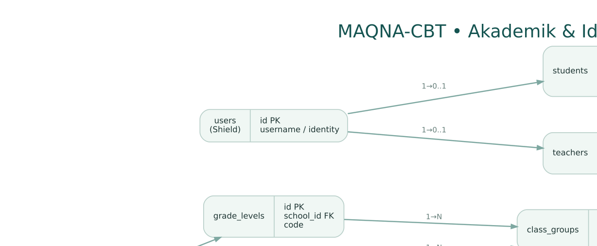
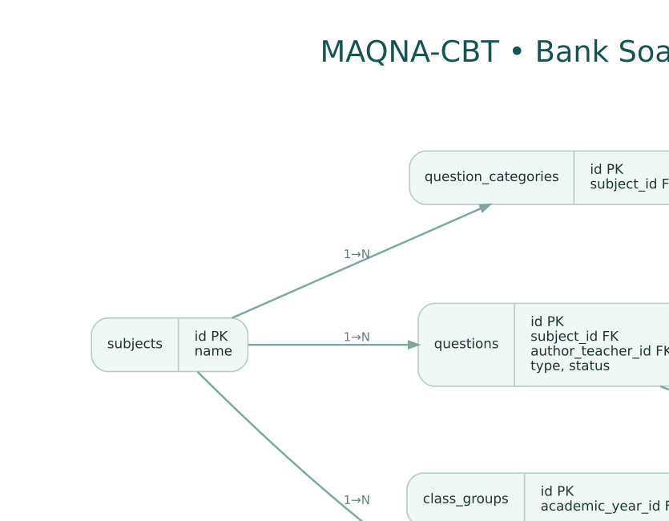
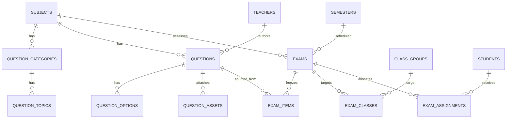
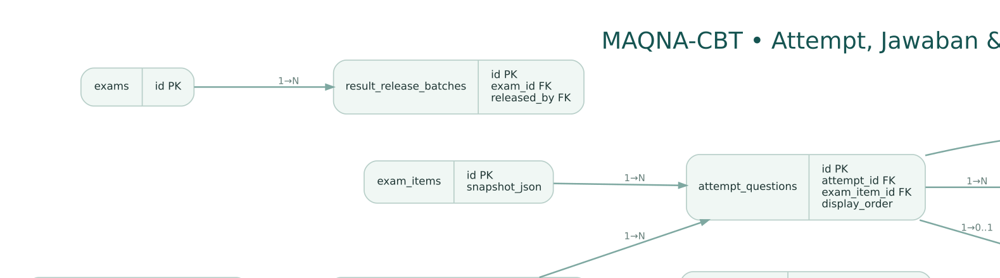
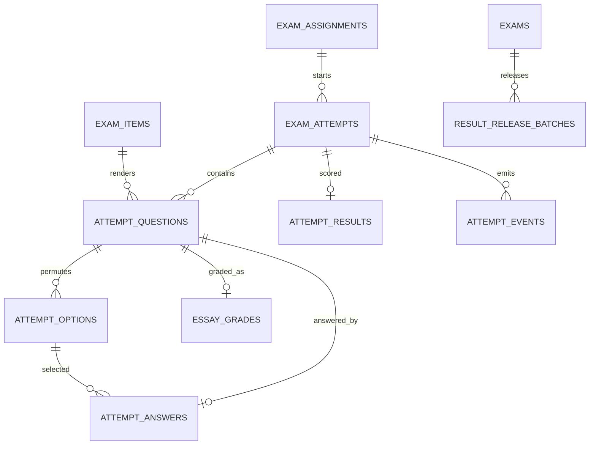
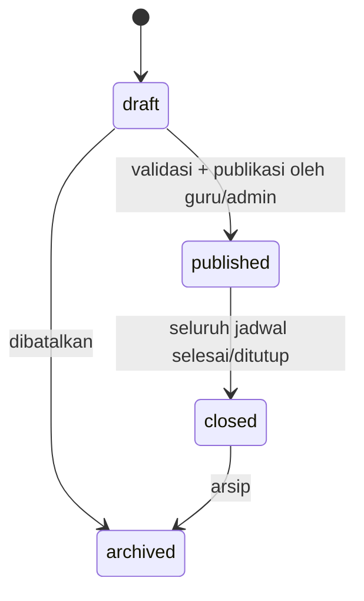
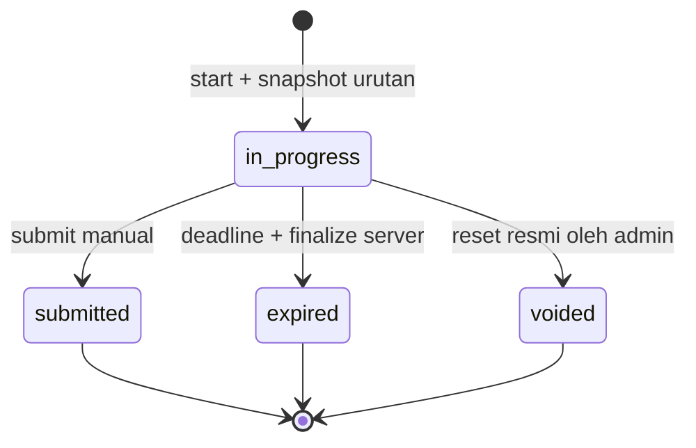

# maqna-cbt — ERD, Permission, dan Struktur Modul CodeIgniter 4

> **Status:** rancangan teknis untuk review; belum merupakan migrations / implementasi aplikasi siap produksi.  
> **Versi:** 1.2 · **Tanggal:** 14 November 2026  
> **Target:** Sekolah / Madrasah (satu institusi pada rilis awal)  
> **Stack:** CodeIgniter 4 REST API · MySQL/MariaDB · React + TypeScript + Vite · shadcn/ui · Tailwind CSS  
> **Rujukan internal:** FRS Sekolah/Madrasah v1.1, 38 fitur terpilih (P0=25, P1=8, P2=5).

## 0. Keputusan yang sudah disetujui

| Topik | Keputusan final | Konsekuensi teknis |
|---|---|---|
| Login siswa | **Username atau email + password** | Username wajib dan unik; email opsional untuk siswa, unik bila diisi/terverifikasi; password disimpan oleh autentikator yang aman. |
| Publikasi ujian | **Guru pengampu kelas terkait atau Admin** | Perlu `teaching_assignments`, penanggung jawab ujian, dan validasi keseluruhan kelas target. |
| Publikasi hasil | **Manual oleh Guru/Admin** | Skor boleh dihitung segera di server, tetapi siswa tidak menerima nilai, kunci, ataupun detail jawaban sebelum `released_at` terisi. |
| Model organisasi | Satu sekolah pada rilis pertama | Semua data domain disarankan mempunyai `school_id` untuk migrasi multi-sekolah di masa depan. |
| Role operasional | `superadmin`, `school_admin`, `teacher`, `proctor`, `student` | Gunakan Shield Groups/Permissions + pengecekan scope object. |
| Attempt | Deadline di server, autosave, resume | Urutan soal/opsi dan kunci disimpan sebagai snapshot, perubahan bank soal tidak mengubah attempt. |

**Catatan keputusan turunan (usulan yang perlu disahkan):** username tidak peka huruf besar/kecil; email siswa boleh kosong; guru boleh merilis hasil hanya untuk ujian yang ia buat/ditugaskan sebagai pengelola **serta** semua kelas target ada dalam lingkup mengajarnya; admin sekolah dapat merilis hasil ujian di sekolahnya. Rilis hasil diblokir jika ada attempt yang masih aktif atau essay belum selesai dinilai, kecuali alur rilis parsial kelak dirancang khusus.

## 1. Rekomendasi desain arsitektur

```
Browser siswa/guru/admin (React + shadcn/ui)
          |
          | HTTPS; same-origin /api/v1/* (proxy pada development)
          v
CodeIgniter 4 REST API
  ├── Auth: CodeIgniter Shield (session + HttpOnly cookie + CSRF)
  ├── Filters: authentication + permission dasar + throttling
  ├── Policies: ownership, school_id, teacher↔subject↔rombel, student↔assignment
  ├── Application Services: publish exam, start/save/submit attempt, grade, release
  ├── Domain Models / Repositories
  ├── Background Commands: expire attempts, repair unfinished grading
  └── Database MySQL/MariaDB + private media storage
```

**Pilihan auth yang disarankan:** Shield *Session Authenticator* karena frontend React berjalan pada domain yang sama dengan backend di produksi. Gunakan cookie `HttpOnly`, `Secure` (HTTPS), `SameSite=Lax/Strict` sesuai topologi, serta proteksi CSRF untuk request mutasi. Saat development pakai Vite proxy `/api` agar tidak terjebak CORS/third-party cookie. Jika kelak membutuhkan mobile native atau API konsumen luar, tinjau autentikator token Shield secara terpisah, bukan menyimpan bearer token buatan sendiri di `localStorage`.

**Penting untuk boilerplate sebelumnya:** backend demo saat ini punya mekanisme login/token sederhana. Jangan menjalankannya bersamaan dengan Shield di produksi; rencanakan migrasi route/auth, hapus credential demo dan seeder sensitif, kemudian tes ulang seluruh flow.

**Konvensi data:** primary key `BIGINT UNSIGNED`, foreign key eksplisit, `created_at`/`updated_at` UTC, kolom nominal skor `DECIMAL` agar tidak terjadi perbedaan pembulatan, status dengan daftar nilai yang divalidasi aplikasi; gunakan soft-delete/deactivation untuk data akademik yang sudah direferensikan ujian. Nama yang digunakan di dokumen ini adalah **nama tabel rancangan**, bukan otomatis tabel bawaan CodeIgniter.

## 2. ERD — tiga domain

Semua diagram tersedia sebagai SVG lokal dalam `diagrams/` dan sumber Mermaid `.mmd`. Gambar lokal dapat dibuka tanpa internet di Markdown Preview VS Code.

### 2.1 ERD Akademik dan Identitas



```mermaid
 erDiagram
    SCHOOLS ||--o{ ACADEMIC_YEARS : has
    ACADEMIC_YEARS ||--o{ SEMESTERS : has
    SCHOOLS ||--o{ SUBJECTS : offers
    SCHOOLS ||--o{ GRADE_LEVELS : defines
    ACADEMIC_YEARS ||--o{ CLASS_GROUPS : has
    GRADE_LEVELS ||--o{ CLASS_GROUPS : contains
    USERS ||--o| STUDENTS : profile
    USERS ||--o| TEACHERS : profile
    CLASS_GROUPS ||--o{ STUDENT_CLASS_MEMBERSHIPS : hosts
    STUDENTS ||--o{ STUDENT_CLASS_MEMBERSHIPS : enrolls
    TEACHERS ||--o{ TEACHING_ASSIGNMENTS : teaches
    SUBJECTS ||--o{ TEACHING_ASSIGNMENTS : subject
    SEMESTERS ||--o{ TEACHING_ASSIGNMENTS : semester
    CLASS_GROUPS ||--o{ TEACHING_ASSIGNMENTS : class
```

**Catatan:** `users`, `auth_identities`, `auth_groups_users`, `auth_permissions_users` dan tabel autentikasi terkait dikelola oleh **CodeIgniter Shield**. Hindari menduplikasi password pada tabel `students` atau `teachers`. Diagram hanya menggambarkan `users` untuk kesederhanaan.

### 2.2 ERD Bank Soal dan Manajemen Ujian





`exam_items.snapshot_json` dibuat saat **publish**, dan berisi pertanyaan/opsi/kunci/rubrik versi ujian tersebut. API siswa **hanya mengirim bentuk yang telah disaring** tanpa kunci, jawaban benar, maupun informasi penilaian rahasia. Jangan kirim JSON mentah `exam_items` ke browser.

### 2.3 ERD Attempt, Jawaban, Nilai & Publikasi





`attempt_results.released_at` adalah **gerbang utama** API hasil siswa. `graded_at` tidak berarti boleh ditampilkan. Untuk siswa, riwayat attempt yang belum dirilis hanya menampilkan status umum (mis. *Selesai — Menunggu hasil*).

## 3. Kamus tabel dan constraint

### 3.1 Auth dan akademik (P0)

| Tabel | Kolom penting | Relasi / constraint utama |
|---|---|---|
| `users` + tabel Shield | username/identities/status | Gunakan migration/struktur asli Shield; jangan menambahkan kolom password custom. |
| `schools` | `id`, `name`, `code`, `timezone`, `status` | `code` unik; satu sekolah aktif pada v1. |
| `students` | `id`, `user_id`, `school_id`, `nis`, `nisn`, `status` | FK `users`,`schools`; UNIQUE(`school_id`,`nis`); `user_id` unik. |
| `teachers` | `id`, `user_id`, `school_id`, `employee_no`, `status` | FK `users`,`schools`; `user_id` unik. |
| `academic_years` | `id`, `school_id`, `name`, `starts_on`, `ends_on`, `is_active` | UNIQUE(`school_id`,`name`); satu aktif per sekolah via transaction/policy. |
| `semesters` | `id`, `academic_year_id`, `term`, `starts_on`, `ends_on`, `is_active` | UNIQUE(`academic_year_id`,`term`), `term` ganjil/genap. |
| `grade_levels` | `id`, `school_id`, `code`, `sort_order` | Contoh VII/VIII/IX, unik per sekolah. |
| `class_groups` | `id`, `school_id`, `academic_year_id`, `grade_level_id`, `name`, `homeroom_teacher_id` | UNIQUE(`school_id`,`academic_year_id`,`name`); `homeroom_teacher_id` nullable. |
| `student_class_memberships` | `id`, `student_id`, `class_group_id`, `academic_year_id`, `started_on`, `ended_on` | Riwayat mutasi tetap disimpan. Maks. **satu rombel utama aktif per tahun**; enforce transaksi + locking, bukan hanya validasi frontend. |
| `subjects` | `id`, `school_id`, `code`, `name`, `is_active` | UNIQUE(`school_id`,`code`). |
| `teaching_assignments` | `id`, `teacher_id`, `subject_id`, `class_group_id`, `semester_id`, `is_active` | UNIQUE kombinasi teacher+subject+class+semester; harus semua dalam sekolah/tahun selaras. |

**Username vs email:** username wajib dan unik secara global pada v1; login menerima salah satu. Email optional untuk siswa tanpa email; jika email disimpan, sebaiknya diverifikasi sebelum dipakai untuk reset password. **NIS adalah nomor akademik**, tidak harus dijadikan username. Sediakan username auto-generated opsional ketika impor siswa.

### 3.2 Bank soal dan ujian (P0)

| Tabel | Kolom penting | Relasi / constraint utama |
|---|---|---|
| `question_categories` | `id`, `subject_id`, `name` | FK `subjects`; unik nama per mapel. |
| `question_topics` | `id`, `category_id`, `name` | FK `question_categories`. |
| `questions` | `id`, `school_id`, `subject_id`, `category_id`, `topic_id`, `author_teacher_id`, `type`, `stem_html`, `default_points`, `status` | `type`: `mcq_single`/`essay`; scope penulis dan mapel. |
| `question_options` | `id`, `question_id`, `position`, `body_html`, `is_correct` | PG: min. 2 opsi dan **tepat 1 benar**, divalidasi saat publikasi. |
| `question_assets` | `id`, `question_id`, `option_id`, `storage_path`, `mime_type`, `size_bytes` | `option_id` nullable; file disimpan private atau akses signed/authorized. |
| `exams` | `id`, `school_id`, `semester_id`, `subject_id`, `owner_teacher_id`, `title`, `exam_type`, `start_at`, `end_at`, `duration_minutes`, `max_attempts`, `passing_score`, `shuffle_questions`, `shuffle_options`, `status`, `published_at` | `passing_score` 0–100; `start_at < end_at`; `owner_teacher_id` nullable untuk ujian milik admin. |
| `exam_items` | `id`, `exam_id`, `question_id`, `position`, `points`, `snapshot_json`, `snapshot_hash` | UNIQUE(`exam_id`,`question_id`) untuk v1; snapshot tidak dapat diubah setelah publish. |
| `exam_classes` | `id`, `exam_id`, `class_group_id` | UNIQUE(`exam_id`,`class_group_id`); semua rombel harus sesuai penugasan guru. |
| `exam_assignments` | `id`, `exam_id`, `student_id`, `class_group_id`, `assigned_at`, `assigned_by`, `status` | UNIQUE(`exam_id`,`student_id`); daftar siswa **dibekukan pada publish** agar perpindahan rombel tidak mengubah ujian lama. |

**Aturan guru saat publish:** `exams.owner_teacher_id = current_teacher.id` **dan** untuk setiap `exam_classes.class_group_id` ada `teaching_assignments` aktif dengan `subject_id = exams.subject_id` dan `semester_id = exams.semester_id`. Admin boleh publish ujian sekolah yang sedang aktif; Super Admin perlu admin policy eksplisit untuk operasi akademik. Jika butuh guru kolaborator, tambahkan `exam_collaborators` nanti; jangan membiarkan semua guru yang sama-sama mengampu mapel mengubah ujian milik orang lain.

### 3.3 Pengerjaan, penilaian dan audit (P0/P1)

| Tabel | Kolom penting | Relasi / constraint utama |
|---|---|---|
| `exam_attempts` | `id`, `exam_assignment_id`, `attempt_no`, `status`, `started_at`, `deadline_at`, `submitted_at`, `submit_reason` | UNIQUE(`exam_assignment_id`,`attempt_no`); status `in_progress/submitted/expired/voided`; satu aktif per assignment via transaksi. |
| `attempt_questions` | `id`, `attempt_id`, `exam_item_id`, `display_order`, `marked_for_review` | UNIQUE(`attempt_id`,`exam_item_id`); urutan dibekukan per attempt. |
| `attempt_options` | `id`, `attempt_question_id`, `original_option_key`, `display_order` | Pilihan acak per attempt; resolve konten/kunci dari snapshot server. |
| `attempt_answers` | `id`, `attempt_question_id`, `selected_attempt_option_id`, `essay_text`, `revision`, `saved_at` | UNIQUE(`attempt_question_id`); pilihan harus milik `attempt_question_id` yang sama; optimistic concurrency pada `revision`. |
| `attempt_results` | `id`, `attempt_id`, `earned_points`, `max_points`, `percentage`, `pass_status`, `grading_status`, `graded_at`, `released_at`, `released_by` | UNIQUE(`attempt_id`); `released_at` null sampai rilis manual; tidak boleh release `pending_review`. |
| `essay_grades` | `id`, `attempt_question_id`, `reviewer_user_id`, `awarded_points`, `feedback`, `graded_at` | UNIQUE(`attempt_question_id`); skor 0..bobot soal; review P1. |
| `attempt_events` | `id`, `attempt_id`, `event_type`, `metadata_json`, `created_at` | Event ringan: start/connection/save failure/submit; pindah tab baru P2. |
| `result_release_batches` | `id`, `exam_id`, `released_by`, `released_at`, `result_count`, `notes` | Referensi audit untuk satu aksi rilis; setiap `attempt_results` yang dirilis ditulis `released_at`/`released_by`. |
| `audit_logs` | `id`, `school_id`, `actor_user_id`, `action`, `resource_type`, `resource_id`, `metadata_json`, `occurred_at` | Log minimal publish dan release wajib P0; manajemen audit penuh/halaman pencarian P1. |

**Tidak disimpan di browser:** kunci jawaban, opsi benar, skor yang belum dirilis, dan rubrik tertutup. Server menghitung skor dan status lulus; field dari client seperti `is_correct`, `score`, `released_at` harus diabaikan untuk API siswa.

### 3.4 Ekstensi bertahap

| Prioritas | Tabel tambahan | Manfaat |
|---|---|---|
| P1 | `import_jobs`, `import_job_rows` | Upload CSV/Excel dengan preview validasi, audit gagal/sukses. |
| P1 | `exam_access_codes` | Kode akses disimpan sebagai hash, dibatasi jadwal/percobaan. |
| P1 | `question_math_assets` (opsional) | Jika LaTeX disimpan inline di `stem_html`, tidak wajib tabel terpisah. |
| P2 | `question_revisions`, `question_reviews` | Versi, review dan approval soal. |
| P2 | `exam_packages`, `exam_package_items` | Paket A/B atau pool soal. |
| P2 | `exam_proctors`, `proctor_incidents` | Penugasan dan catatan pengawas. |
| P2 | `question_item_statistics` (opsional/materialized) | Agregat tingkat kesukaran dan analisis distraktor. |

### 3.5 Foreign key, index dan integritas yang sangat penting

1. Index: `students(school_id,nis)`, `users(username)`, `teaching_assignments(teacher_id,semester_id,subject_id,class_group_id,is_active)`, `exam_assignments(exam_id,student_id)`, `exam_attempts(exam_assignment_id,status)`, `attempt_questions(attempt_id,display_order)`, `attempt_answers(attempt_question_id,revision)`, `attempt_results(attempt_id,released_at)`, `audit_logs(school_id,occurred_at)`.
2. Jangan ubah/delete `exam_items.snapshot_json` jika ada attempt. Draft exam dapat diubah; setelah publish buat revisi ujian baru atau kebijakan amendment eksplisit.
3. FK dan policy wajib menjamin `school_id` selaras sepanjang tree. Jangan mengandalkan `school_id` dari body request pengguna.
4. Perubahan jadwal/passing grade setelah ada attempt disarankan **dilarang** pada v1; buat ujian baru untuk koreksi yang mengubah fairness.
5. Perpindahan kelas mempertahankan membership historis; ujian tertarget siswa lewat snapshot assignment, bukan query live rombel saat peserta ujian.
6. `exam_attempts` start/submit dan `attempt_results` grade/release diproses dengan transaksi, locking, serta idempotency.
7. Waktu simpan UTC, display sesuai `schools.timezone`; batas ujian pakai waktu database/server tersinkronisasi.

## 4. Permission matrix: kode granular dan cakupan

Legenda: **A** = Admin Sekolah (seluruh sekolah); **G*** = Guru (hanya ujian/kelas/mapel sesuai penugasan); **P*** = Pengawas (hanya ujian ditugaskan); **S** = siswa atas datanya sendiri; **SA** = Super Admin teknis (bukan otomatis peserta). Semua permission diperiksa di backend.

| Permission code | SA | A | G | P | S | Scope & aturan |
|---|:---:|:---:|:---:|:---:|:---:|---|
| `system.manage` | ✓ | — | — | — | — | Pengaturan aplikasi, autentikasi. |
| `roles.manage` | ✓ | — | — | — | — | Penambahan role/permission sensitif. |
| `academic.manage` | ✓ | ✓ | — | — | — | Tahun ajaran, semester, tingkat, rombel. |
| `users.manage` | ✓ | ✓ | — | — | — | Buat/nonaktif siswa & guru di sekolah. |
| `subjects.manage` | ✓ | ✓ | — | — | — | Master mapel. |
| `teaching.manage` | ✓ | ✓ | — | — | — | Penugasan guru-mapel-rombel. |
| `questions.read` | ✓ | ✓ | ✓* | — | — | Guru: bank soal sendiri atau yang dibagikan eksplisit. |
| `questions.create` | ✓ | ✓ | ✓* | — | — | Guru: hanya mapel yang diampu. |
| `questions.update` | ✓ | ✓ | ✓* | — | — | Guru: soal miliknya; tidak mengubah snapshot ujian. |
| `exams.create` | ✓ | ✓ | ✓* | — | — | Guru: dalam semester/mapel yang diampu. |
| `exams.update` | ✓ | ✓ | ✓* | — | — | Hanya draft; guru harus owner. |
| `exams.assign` | ✓ | ✓ | ✓* | — | — | Target siswa hanya kelas dalam teaching assignments. |
| `exams.publish` | ✓ | ✓ | ✓* | — | — | **Keputusan final:** guru owner + semua kelas diampu. |
| `exams.close` | ✓ | ✓ | ✓* | — | — | Admin / guru owner sesuai policy. |
| `attempts.start` | — | — | — | — | ✓ | Hanya siswa yang punya `exam_assignment`. |
| `attempts.save` | — | — | — | — | ✓ | Hanya attempt aktif miliknya, sebelum deadline. |
| `attempts.submit` | — | — | — | — | ✓ | Hanya attempt miliknya; idempotent. |
| `attempts.reset` | ✓ | ✓ | — | — | — | Wajib alasan dan audit, tidak hapus histori. |
| `monitor.read` | ✓ | ✓ | ✓* | ✓* | — | P2 full monitoring; P0 status dasar admin/guru. |
| `results.read` | ✓ | ✓ | ✓* | — | ✓* | Siswa hanya hasil sendiri dengan `released_at != null`. |
| `results.grade` | ✓ | ✓ | ✓* | — | — | Essay P1, guru ujian terkait. |
| `results.release` | ✓ | ✓ | ✓* | — | — | **Keputusan final:** manual; hanya hasil grade final. |
| `results.export` | ✓ | ✓ | ✓* | — | — | Export P1, filter kelas/mapel milik guru. |
| `audit.read` | ✓ | ✓* | — | — | — | P1; admin terbatas per sekolah. |
| `profile.update_self` | ✓ | ✓ | ✓ | ✓ | ✓ | Hanya profil sendiri, bukan role/rombel. |

**Catatan kritis:** Shield hanya menjawab *apakah pengguna mempunyai permission* (`$user->can('exams.publish')`). **Object policy** tetap memeriksa *apakah ujian X miliknya* dan *apakah guru mengampu semua rombel yang dituju*. Route React yang tersembunyi **bukan** pengaman.

### 4.1 Pseudocode kebijakan publish

```php
// Contoh algoritma aplikasi, bukan class implementasi siap tempel.
function canPublishExam(User $actor, Exam $exam): bool
{
    if (! $actor->can('exams.publish') || $exam->status !== 'draft') return false;
    if (! inCurrentSchool($actor, $exam->school_id)) return false;
    if (isSchoolAdmin($actor)) return true;
    if (! isTeacher($actor) || $exam->owner_teacher_id !== teacherId($actor)) return false;

    $classes = getExamClassIds($exam->id);
    if (count($classes) === 0) return false;

    // Query harus memastikan SEMUA class target diampu oleh guru untuk mapel & semester itu.
    return count($classes) === countAssignedClasses(
        teacherId($actor), $exam->subject_id, $exam->semester_id, $classes
    );
}
```

**Poin review:** `countAssignedClasses` harus menghitung distinct class ID, hanya assignment aktif, dan memakai DB transaksi ketika mem-publish agar penugasan tidak berubah di tengah operasi.

### 4.2 Pseudocode kebijakan rilis hasil

```text
request: POST /api/v1/exams/{examId}/results/release
1. Authenticate + permission results.release.
2. Load ujian dan current school; cek admin atau guru owner yang diampu seluruh kelas target.
3. Lock ujian / hasil untuk mencegah dua publish bersamaan.
4. Tolak jika ada attempt aktif / belum tertutup atau essay pending_review.
5. Tolak jika ujian masih berpotensi memberi kesempatan peserta melihat kunci (kunci tetap terpisah).
6. Isi attempt_results.released_at & released_by untuk result yang eligible.
7. Tulis result_release_batches dan audit_logs.
8. Return jumlah rilis, waktu rilis, actor. Lakukan commit transaction.
```

Pemisahan `released_at` (nilai boleh dilihat) dan `review_allowed_at`/kebijakan review (kunci boleh dilihat) **wajib** dipertahankan. Meskipun nilai dirilis, kunci tidak otomatis dapat diakses siswa.

## 5. Alur status dan transaksi utama

### 5.1 Exam Lifecycle



`published` berarti sudah terjadwal dan dapat muncul di dashboard target, **bukan** semua siswa langsung bisa mulai. Start tetap disyaratkan `start_at <= server_now < end_at`.

### 5.2 Attempt Lifecycle



- Deadline efektif = `min(started_at + duration_minutes, exams.end_at)`; jika ujian ingin memberi durasi penuh untuk peserta terlambat, perlu aturan berbeda yang disetujui.
- Request save setelah deadline selalu ditolak, walau JavaScript timer siswa masih menunjukkan sisa waktu.
- Finalisasi otomatis terjadi via request terdekat **dan** scheduler/cron fallback; jangan hanya mengandalkan tab browser siswa.
- Start dan submit wajib idempotent. Dengan `exam_assignment` dikunci per transaksi, dua perangkat tidak boleh membuat attempt ganda secara race.

### 5.3 Alur Admin, Guru, Siswa & Pengawas

**Admin Sekolah:** aktifkan tahun ajaran → semester → rombel → impor siswa → guru → mata pelajaran → teaching assignment → cek jadwal ujian → pantau status → validasi laporan.

**Guru:** buat kategori/topik/soal → pilih kelas yang diajar → draft ujian → pilih soal & parameter → preview soal/target → publish → tunggu selesai → nilai essay (jika ada) → rilis hasil manual → analisis nilai.

**Siswa:** login username/email → dashboard ujian sesuai assignment → instruksi → start attempt → soal + timer + autosave → navigasi/mark review → submit atau expired → status *Menunggu hasil* → nilai muncul setelah release.

**Pengawas:** menerima penugasan ujian (P2) → memantau siswa dari kelas target → mencatat insiden → menyerahkan tindak lanjut ke admin; tidak boleh mengubah jawaban atau membuka kunci.

## 6. Struktur modul CodeIgniter 4 yang disarankan

**Rekomendasi:** *modular monolith* di dalam `app/`, bukan langsung microservices. Controller tipis; business rule berada di `Services` dan `Policies`. Struktur berikut memakai namespace `App\\...` dan tetap mengikuti struktur CodeIgniter 4 standar.

```text
backend/
├── app/
│   ├── Config/
│   │   ├── Routes.php
│   │   ├── Filters.php
│   │   ├── Auth.php                   # CodeIgniter Shield
│   │   ├── AuthGroups.php             # groups, permissions, matrix
│   │   ├── Cors.php
│   │   └── MaqnaCbt.php              # konfigurasi domain
│   ├── Controllers/
│   │   └── Api/V1/
│   │       ├── AuthController.php
│   │       ├── ProfileController.php
│   │       ├── Academic/
│   │       │   ├── AcademicYearController.php
│   │       │   ├── SemesterController.php
│   │       │   ├── ClassGroupController.php
│   │       │   └── TeachingAssignmentController.php
│   │       ├── Users/
│   │       │   ├── StudentController.php
│   │       │   └── TeacherController.php
│   │       ├── Questions/
│   │       │   ├── QuestionController.php
│   │       │   └── QuestionAssetController.php
│   │       ├── Exams/
│   │       │   ├── ExamController.php
│   │       │   ├── ExamAssignmentController.php
│   │       │   ├── ExamPublishController.php
│   │       │   └── ExamAttemptController.php
│   │       ├── Results/
│   │       │   ├── GradeController.php
│   │       │   ├── ResultController.php
│   │       │   └── ResultReleaseController.php
│   │       ├── Reports/ReportController.php
│   │       └── Monitoring/MonitoringController.php
│   ├── Filters/
│   │   ├── ApiJsonFilter.php
│   │   └── SchoolContextFilter.php    # jangan percaya school_id dari client
│   ├── Models/
│   │   ├── Academic/...              # models hanya akses data
│   │   ├── Questions/...
│   │   ├── Exams/...
│   │   └── Results/...
│   ├── Services/
│   │   ├── Auth/UserProvisioningService.php
│   │   ├── Academic/EnrollmentService.php
│   │   ├── Academic/TeachingAssignmentService.php
│   │   ├── Questions/QuestionService.php
│   │   ├── Exams/ExamPublishService.php
│   │   ├── Exams/ExamAssignmentService.php
│   │   ├── Attempts/StartAttemptService.php
│   │   ├── Attempts/SaveAnswerService.php
│   │   ├── Attempts/FinalizeAttemptService.php
│   │   ├── Grading/AutoGradingService.php
│   │   ├── Grading/EssayGradingService.php
│   │   ├── Results/ReleaseResultsService.php
│   │   └── Audit/AuditService.php
│   ├── Policies/
│   │   ├── SchoolPolicy.php
│   │   ├── TeachingScopePolicy.php
│   │   ├── QuestionPolicy.php
│   │   ├── ExamPolicy.php
│   │   ├── AttemptPolicy.php
│   │   └── ResultPolicy.php
│   ├── Validation/
│   │   ├── ExamRules.php
│   │   ├── QuestionRules.php
│   │   └── AnswerRules.php
│   ├── Database/
│   │   ├── Migrations/
│   │   │   ├── ...CreateSchoolAndAcademicTables.php
│   │   │   ├── ...CreateQuestionTables.php
│   │   │   ├── ...CreateExamTables.php
│   │   │   └── ...CreateAttemptAndResultTables.php
│   │   └── Seeds/
│   │       ├── SchoolSeeder.php
│   │       ├── AcademicMasterSeeder.php
│   │       └── DemoAccountsSeeder.php # hanya development
│   ├── Commands/
│   │   ├── ExpireExamAttempts.php
│   │   └── RebuildPendingGrades.php
│   └── Libraries/                      # utility murni, bila dibutuhkan
├── public/                              # document root web server
├── writable/                            # log/cache/private data sesuai konfigurasi
├── tests/
│   ├── Feature/Api/
│   ├── Integration/ExamLifecycleTest.php
│   ├── Integration/PermissionScopeTest.php
│   └── Unit/...
├── vendor/
├── composer.json
└── spark
```

**Pembagian tanggung jawab:**

- Controller: parsing request, auth, validasi input, memanggil Service, merespons JSON.
- Policy: menerima actor+resource dan mengevaluasi hak akses, kepemilikan, scope rombel serta `school_id`.
- Service: transaksi lintas tabel, snapshot saat publish, start/submit idempotent, perhitungan nilai, rilis.
- Model: operasi DB. Jangan menaruh aturan bisnis multi-tabel di controller atau membuat `BaseModel` global yang besar.
- Commands: tugas yang harus selesai walaupun tidak ada request browser (deadline/grade retry).

**Jika aplikasi makin besar:** pindahkan per domain ke namespace modules (`Modules\\Academic`, `Modules\\Exams`) dengan PSR-4, tanpa harus mengganti desain domain. Saat ini struktur `app/` lebih mudah dipelihara.

### 6.1 Struktur frontend yang sesuai

```text
frontend/src/
├── app/                          # routes, guards, auth provider
├── components/ui/                # shadcn/ui (Button, Card, Table, Sheet, Dialog...)
├── components/layout/            # dashboard sidebar/header
├── features/
│   ├── academic/
│   ├── users/
│   ├── questions/
│   ├── exams/
│   ├── attempts/                # timer, autosave queue, question palette
│   ├── grading/
│   ├── results/
│   └── monitoring/
├── lib/api-client.ts
├── lib/permissions.ts            # hanya untuk affordance UI, bukan security
└── styles/tokens.css             # warna, spacing, radius maqna-cbt
```

**Layout CBT:** desktop sidebar navigasi nomor soal; mobile gunakan `Sheet` shadcn/ui. Gunakan indikator offline/save status; jangan menampilkan `Saved` sebelum response server sukses. Warna brand utama mengikuti dokumen desain maqna-cbt, tetapi implementasi fitur tidak terikat pada referensi Testora.

## 7. REST API v1 yang perlu disiapkan

| Method | Endpoint | Hak akses | Proses utama |
|---|---|---|---|
| POST | `/api/v1/auth/login` | Public | Username/email+password; rate limit; session cookie; CSRF bootstrap. |
| POST | `/api/v1/auth/logout` | Authenticated | Logout dan revoke sesi. |
| GET | `/api/v1/auth/me` | Authenticated | Profil, role dan permission UI yang sudah disaring. |
| POST | `/api/v1/auth/forgot-password` | Public | Permintaan reset tanpa account enumeration. |
| GET/POST | `/api/v1/academic-years` | Admin / academic.manage | Periode akademik. |
| GET/POST | `/api/v1/class-groups` | Admin / academic.manage | Kelas/rombel. |
| GET/POST | `/api/v1/teaching-assignments` | Admin / teaching.manage | Penugasan guru. |
| GET/POST | `/api/v1/students` | Admin / users.manage | Kelola siswa. |
| GET/POST | `/api/v1/teachers` | Admin / users.manage | Kelola guru. |
| GET/POST | `/api/v1/questions` | Admin/Guru* | CRUD dan filter bank soal. |
| POST | `/api/v1/questions/{id}/assets` | Admin/Guru* | Upload gambar privat. |
| GET/POST | `/api/v1/exams` | Admin/Guru* | Daftar, buat draft ujian. |
| PATCH | `/api/v1/exams/{id}` | Admin/Guru owner | Update draft saja. |
| POST | `/api/v1/exams/{id}/publish` | `exams.publish` + scope | Snapshot soal, target siswa dan validasi transaksi. |
| GET | `/api/v1/student/exams` | `attempts.start` | Ujian tertarget milik siswa. |
| POST | `/api/v1/exams/{id}/attempts` | `attempts.start` + assignment diri | Buat atau kembalikan attempt aktif. |
| GET | `/api/v1/attempts/{id}` | `attempts.save` + pemilik | State pengerjaan tanpa kunci jawaban. |
| PUT | `/api/v1/attempts/{id}/answers/{attemptQuestionId}` | `attempts.save` + pemilik | Autosave dengan `expected_revision`. |
| PATCH | `/api/v1/attempts/{id}/questions/{attemptQuestionId}/mark` | `attempts.save` + pemilik | Tandai untuk ditinjau. |
| POST | `/api/v1/attempts/{id}/submit` | `attempts.submit` + pemilik | Submit/finalize idempotent. |
| GET | `/api/v1/exams/{id}/results` | `results.read` + scope | Hasil kelas bagi guru/admin. |
| POST | `/api/v1/exams/{id}/results/release` | `results.release` + scope | Rilis hasil manual, batch transactional + audit. |
| GET | `/api/v1/student/results` | Student diri | Hanya hasil `released_at IS NOT NULL`. |
| GET | `/api/v1/reports/exams` | Admin/Guru* | Statistik hasil sesuai scope. |
| POST | `/api/v1/attempts/{id}/essay-grades` | `results.grade` + scope (P1) | Nilai essay. |

**Respons umum:** `401 Unauthorized` bila belum login; `403 Forbidden` bila tidak punya izin/scope; `404 Not Found` untuk resource di luar scope saat perlu menghindari enumeration; `409 Conflict` untuk stale autosave/sesi berubah; `422 Unprocessable Entity` untuk validasi; `429 Too Many Requests` untuk rate limit.

### 7.1 Contoh kontrak autosave

```http
PUT /api/v1/attempts/901/answers/4821
Content-Type: application/json

{
  "selected_option_id": 11228,
  "expected_revision": 4
}
```

```json
{
  "data": {
    "attempt_question_id": 4821,
    "revision": 5,
    "saved_at": "2026-11-14T03:42:00Z",
    "save_status": "saved"
  }
}
```

Jika revision tidak cocok, backend memberi `409 Conflict` berisi revision terkini dan state yang diizinkan. Client tidak menimpa server secara diam-diam; antrekan autosave memastikan urutan per soal. Buffer lokal adalah bantuan sementara, **bukan** bukti jawaban sudah tersimpan.

### 7.2 Contoh respons hasil siswa sebelum dan sesudah release

```json
{
  "exam_id": 55,
  "attempt_status": "submitted",
  "result_status": "waiting_for_release",
  "score": null,
  "pass_status": null
}
```

Setelah rilis manual:

```json
{
  "exam_id": 55,
  "attempt_status": "submitted",
  "result_status": "released",
  "score": 82.50,
  "pass_status": "passed",
  "released_at": "2026-11-14T08:00:00Z"
}
```

API jawaban benar/pembahasan **berbeda dari** API nilai, dilindungi kebijakan review dan tidak dibuka hanya karena hasil sudah dirilis.

## 8. Prioritas implementasi yang bergantung pada keputusan terbaru

| Sprint | Target keluaran | Prioritas | Acceptance / gate |
|---|---|---|---|
| **S0** | CI4 + Shield, React API client, login username/email, groups, CSRF/session, test infra | P0 | Semua route privat tertutup; role palsu dan session expired ditolak. |
| **S1** | School, tahun ajaran, semester, rombel, siswa, guru, mapel, teaching assignment | Pendukung P0 | Guru A tidak dapat memilih kelas di luar assignment. |
| **S2** | Bank soal PG/gambar, master kategori/topik, review dasar | P0 | Satu kunci valid, file aman, query tanpa bocor kunci ke siswa. |
| **S3** | Draft exam, aturan waktu, target rombel/siswa, teacher publish scope, exam snapshot | P0 | Guru tidak dapat publish kelas asing; snapshot konsisten. |
| **S4** | Start attempt, timer server, autosave revision, mark review, resume, submit/expiry | P0 | Refresh/drop koneksi tanpa mengacak ulang dan tanpa double attempt. |
| **S5** | Auto grading, passing grade, laporan dan **manual result release** | P0 | Siswa tidak melihat nilai sebelum `released_at`; audit release tercatat. |
| **S6** | Import siswa/soal, essay, LaTeX, token, review jawaban, export, audit UI | P1 | Essay pending tidak dirilis; export dan review di-scope. |
| **S7** | Versi soal, paket ujian, deteksi tab, monitoring, analisis butir | P2 | History/snapshot tidak berubah; monitoring tidak bocorkan kunci. |

**Jangan melanjutkan ke S4 sebelum S1 dan S3 benar:** aturan kelas dan ujian menentukan apakah peserta sah memulai dan menyimpan jawaban.

### 8.1 Contoh task awal per sprint untuk Codex

- S0: instal CI4, instal Shield, konfigurasi AuthGroups, aktifkan session auth/CSRF, buat `/api/v1/auth/me`, tulis test anonymous vs forbidden, integrasi React `/api` proxy.
- S1: buat migrations `schools`, `academic_years`, `semesters`, `grade_levels`, `class_groups`, `students`, `teachers`, `student_class_memberships`, `teaching_assignments`; factory & test scope guru.
- S2: buat editor PG, opsi, pengelolaan gambar private, sanitasi HTML, tambah test API tidak membocorkan `is_correct`.
- S3: implement `ExamPublishService` transaksional dengan exam snapshot dan freeze `exam_assignments`; test guru di kelas berbeda.
- S4: implement `StartAttemptService`, autosave `expected_revision`, expire command, submit idempotent; test parallel requests.
- S5: implement `AutoGradingService` dan `ReleaseResultsService`, test results disembunyikan walaupun sudah graded.

## 9. Skenario uji wajib

| ID | Uji | Hasil yang diharapkan |
|---|---|---|
| T01 | Siswa login memakai username | Sukses bila password benar; session aman. |
| T02 | Siswa login memakai email terverifikasi | Sukses; email tidak harus tersedia untuk semua siswa. |
| T03 | Guru kelas VII-A melihat ujian VIII-B via mengganti URL | 403/404; data siswa VIII-B tidak terbuka. |
| T04 | Guru VII-A mengirim publish ujian target VII-A **dan** VIII-B | Ditolak karena target tidak semuanya diampu. |
| T05 | Admin publish ujian dengan soal tanpa kunci | Ditolak 422; tidak ada assignment yang tercipta. |
| T06 | Edit bank soal setelah publish | Exam snapshot dan attempt tetap sama. |
| T07 | Dua request start dari perangkat berbeda dalam waktu bersamaan | Paling banyak satu attempt aktif/nomor attempt yang valid. |
| T08 | Refresh halaman saat attempt berjalan | Urutan soal dan jawaban tersimpan tetap sama. |
| T09 | Autosave revision 5 datang setelah revision 6 | Ditolak 409; jawaban terbaru tidak ditimpa. |
| T10 | Mengubah waktu lokal perangkat | Deadline ujian tidak berubah. |
| T11 | Browser ditutup dan tidak ada request setelah deadline | Scheduler menutup attempt dan memproses nilai. |
| T12 | Submit manual diulang berkali-kali | Satu proses grade/result; respons idempotent. |
| T13 | Siswa meminta hasil sebelum guru merilis | `waiting_for_release`, `score=null`, tanpa kunci. |
| T14 | Guru kelas asing memanggil endpoint release | Ditolak 403/404. |
| T15 | Guru berizin merilis hasil yang telah final | Nilai siswa muncul setelah audit release disimpan. |
| T16 | Ada essay belum dinilai dan diminta release | Ditolak, tidak ada rilis parsial tak sengaja. |
| T17 | Siswa meminta jawaban benar setelah nilai rilis, review dinonaktifkan | Tidak mendapat kunci. |
| T18 | Admin menonaktifkan siswa setelah ujian lama selesai | Riwayat hasil tetap utuh. |
| T19 | Memasukkan ID file gambar orang lain | API validasi hak akses; file private. |
| T20 | Change roles atau reset attempt | Audit aman, identitas aktor dan alasan tersedia. |

## 10. Hal yang masih perlu keputusan (sebelum final migrations)

1. **Hasil bila max_attempts > 1:** nilai terbaik, terakhir, atau pertama? Default usulan untuk ujian formal `first`; latihan `highest`.
2. **Rilis hasil ketika ujian terdiri dari banyak gelombang:** semuanya setelah `end_at` untuk keamanan soal; atau per-kelas/gelombang dengan kunci tetap disembunyikan?
3. **Akun siswa yang tidak punya email:** reset oleh operator, atau sekolah menyediakan email? Default usulan reset via operator dengan verifikasi identitas.
4. **Akses guru terhadap bank soal guru lain:** default private per pembuat, kolaborasi dapat dibuat setelah mekanismenya jelas.
5. **Perpindahan siswa di tengah semester:** tetap mengikuti assignment awal atau admin menerbitkan assignment susulan eksplisit? Default dibekukan.
6. **Bentuk nilai akhir:** percentage 0–100 dan passing grade per ujian; pembobotan paket atau mapel di luar MVP.
7. **Policy gawai ganda:** default satu attempt aktif dan sesi pengerjaan lain dikunci; harus disertai penanganan reconnect yang tidak mengganggu.

## 11. Cara menggunakan dokumen offline

- Buka file Markdown ini di VS Code; `Ctrl+Shift+V` untuk Preview. Tiga diagram SVG berada di folder `diagrams/` dan **tidak** membutuhkan internet.
- File `.mmd` dapat dibuka sebagai sumber Mermaid/diolah kemudian; gambar SVG yang sudah dirender merupakan versi offline siap dilihat.
- `matrices/permissions.csv` bisa diimpor ke spreadsheet untuk pemeriksaan role.
- `examples/AuthGroups.example.php` dan `examples/Routes.example.php` adalah **contoh arsitektur**, harus disesuaikan dengan instalasi Shield, nama controller, dan konfigurasi CSRF sebelum digunakan.

## 12. Referensi resmi (untuk validasi implementasi; tidak dibutuhkan untuk membaca dokumen)

- CodeIgniter 4 User Guide: https://codeigniter.com/user_guide/
- CodeIgniter 4 Routing: https://codeigniter4.github.io/userguide/incoming/routing.html
- CodeIgniter 4 Database Migrations: https://codeigniter.com/user_guide/dbmgmt/migration.html
- CodeIgniter Shield: https://shield.codeigniter.com/
- Shield Authorization: https://shield.codeigniter.com/latest/references/authorization/
- Shield Session Filters: https://shield.codeigniter.com/latest/references/controller_filters/

---

**Rekomendasi final:** tetapkan ERD akademik dan policy guru terlebih dahulu, baru bangun engine ujian. Dengan ini hak akses guru untuk publish ujian dan release hasil dapat ditegakkan konsisten tanpa celah lewat perubahan ID di API.
